# });


*Beep, beep…*

**+ Hello?**

**-Design Twitter!**

**+ But how… *click***

Yes, but how?

Let’s look at Twitter. (It’s X now, but I prefer to call it Twitter.)

When we open it from the application, lots of posts show up on our homepage. This is our timeline. When we scroll down the page, new posts are recommended to us. Some of them are from profiles followed by millions of people. They have thousands, sometimes millions, of likes and comments below them.

And we have a **+ button**. When we click it, an empty, text-editable box appears on the page, along with our famous **POST** button. We can write something and post it from this section. We can also attach media such as photos and videos.

Okay, so we have recommended posts from different profiles, text posts that we can create, media files that can be included in our posts, and like counts and comments for each post.

You are designing these mechanisms in our system. Let’s just forget about signing in and other Twitter mechanisms like AI, blocking, or following profiles. Consider that we are part of a team, and we have been assigned these parts.

Go on. Design the System of Twitter.

Oh, sorry. I forgot that you don’t have any information about System Design.

Don’t worry. I’m here to design it with you.

**Follow me!**

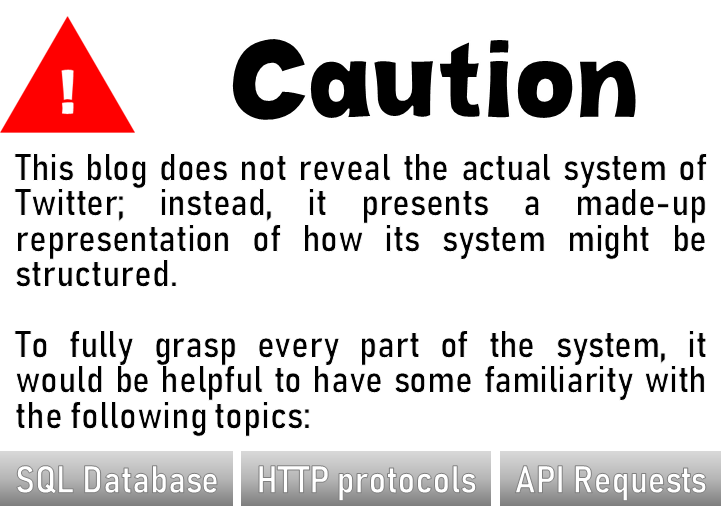

---

### Lay-out:

- What a System Is? How Can We Design One??
    - HTTP Structure
        - Secure HTTP
    - Needs for Our System
- Handling Needs
    - Clusters of Servers and How Do We Manage Them?
        - Proxy, Load Balancing
        - Hashing
        - Leader Election
        - Rate Limiting
        - CDN
    - Enhanced Availability
        - Scaling the System, Horizontal/Vertical Scaling
    - Today’s Technologies
- API Functions
- Creating The Database
    - Relational SQL
        - Querying
        - ACID
        - Indexing
    - NoSQL
        - K/V Storage Structure
        - Blob Storage
- Caching
- Synchrone and Asynchrone Processes
- Pub/Sub Architecture
- System of Twitter
    - Complete Schemes
- Last but Not Least

---

## What a System Is? How Can We Design One??

The average internet user spends around 6 hours every day interacting with networked systems — more than 100 days per year. And more than half of that time is spent through a device sitting in our pockets. So when a company asks you to design a system, remember: you have already been a user of thousands of them. You just need to learn how to see what happens behind the screen.

But what exactly do we mean by “system”?

Every time you send a message, scroll through your feed, watch a video, order something online, or check your bank account, you are interacting with a system. 

When you click the “POST” button on Twitter, a few things happen. You hear some clicks, something starts moving in the background, and moments later, your post is shared. 

Is this simply the universal power of a button, or is there something more happening behind it? With a single click, you trigger an API request that travels through your internet connection.

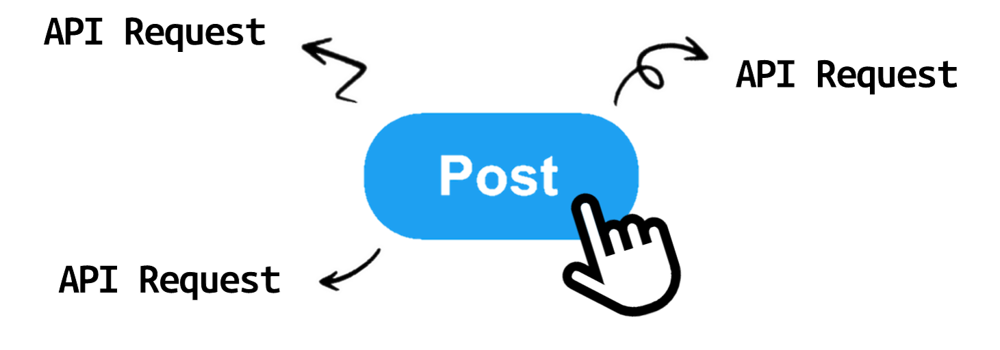

“I request this. I want this…”

Suppose we are a hungry guy in a restaurant, and we order some food from the waiter. Our order needs to have a specific structure for the waiter—or the restaurant—to understand what we want. Once they understand what they need to serve, they can start the processes required to make it happen.

We, the hungry guys, are actually the **clients**, and the restaurant is the **server**. The specific format our order follows is actually a **protocol**.

### HTTP Structure

In the world of the Internet, requests follow protocols as well. We are going to use the most common and appropriate one: **HTTP, the Hypertext Transfer Protocol.**

An HTTP request is actually structured data. It contains different pieces of information in its **headers** and **body**.

Yes, it has parts.

Let’s take a look at them:

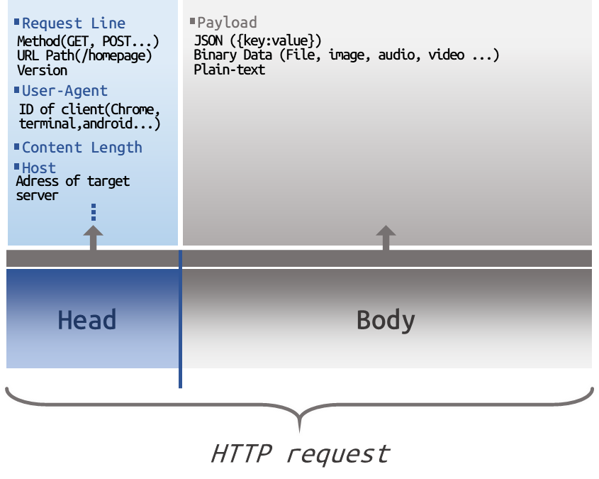

If you already know these terms, good for you. But if you are seeing them for the first time, don’t be scared. We are just going to scratch the surface of them.

As the data structured with HTTP travels through Wi-Fi waves and cables, something is there to catch it. This is the server I mentioned before.

The server looks at the request and sees from its headers that a client at a specific IP address is sending this request. So, it processes the request and sends a response back to that client.

All the routers along the way help carry this request and response to the right addresses, much like postmen delivering a letter. But they are not really our concern here.

Our goal is to understand what data should be inside the requests and responses, what the server should do when it receives a request, and what happens when the server decides not to serve it and returns an error instead.

<aside>
💡

This request-and-response process can happen within milliseconds. An HTTP request may contain only a small amount of data. But when a server receives millions of these requests, each one triggers software and hardware processes that require computational power. 

So, how does a server handle millions of requests on its own?

Think about your phone. When you open an application, software and hardware processes start running to make it work. When you open more applications, your phone has more processes to handle, and it may start to slow down.

A server is not so different. It has RAM, storage, a processor. The difference is that instead of serving one person using a few applications, a server may have to handle millions of requests from users at the same time.

And this is exactly what we are here to do: **design the system so that it can handle this workload without crashing and process requests as efficiently as possible.**

That is a part of **system design**.

</aside>

But for now, we are looking protocol itself. If you have a knowledge, you can pass to the Needs part.

If we look at the image again, there is a section in the header called **METHOD**. Every request is divided according to its method. Each method asks the server to do something different. So, let’s take a look at what some of these methods do:

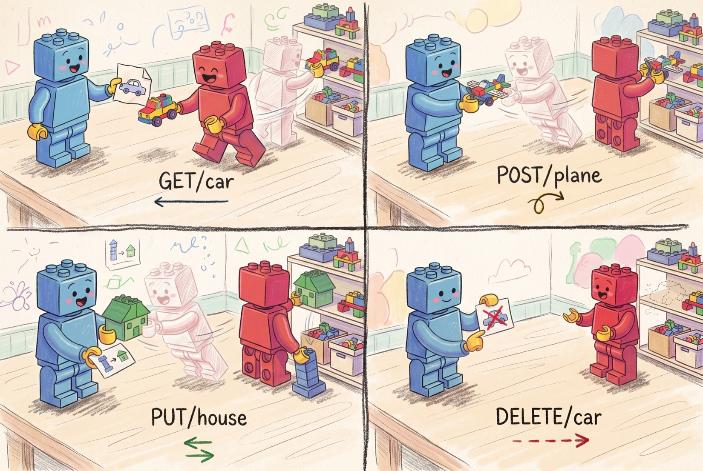

As you see in the picture, each method sent by the client (blue) has a different impact on the server (red). These methods are the actual skeleton of our architecture. Let’s go deeper and look at the structure of the requests then.

```jsx
GET /car HTTP/1.1
Host: api.fundamantals-system-design.com
Accept: application/json
User-Agent: Blue-Robot-Client/1.0
```

```jsx
POST /plane HTTP/1.1
Host: api.fundemantals-system-design.com
Content-Type: application/json
Content-Length: 65

{
  "name": "Lego Plane",
  "color": "colorful",
  "propeller": true
}
```

If you look closer, in the POST method, we have a body part inside curly brackets. Thus, we can say that different methods may have different structures.

If the information or the structure of the request is incorrect, the server definitely must not accept it.

We have a decision-making mechanism on servers, as they are computers on a network. They must decide what response should be sent back to the client. There are many different possible responses:

- **200 OK:** The request was successful. Everything is fine.
- **301 Moved Permanently:** A redirection. The page has been permanently moved to another address.
- **400 Bad Request:** The client sent an invalid request.
- **404 Not Found:** The requested page or resource could not be found.
- **500 Internal Server Error:** Something went wrong on the server side.

<aside>
💡

System design is about implementing the technologies and strategies needed to handle every problem a server may encounter, while making sure that its responses do not break the rest of the system.

</aside>

#### Secure HTTP

How does the client know that it has successfully connected to the server? And how does it know that the communication is still working?

For this, we have a process called a **handshake**. Before the blue robot sends the famous `GET /car` request to the red robot, it first needs to establish a connection with it. This is done through a TCP process called the **3-Way Handshake**.

**SYN: “Hello, are you available?**

**SYN-ACK:  “Yes, I’m here. Are you ready?”**

**ACK: “Great, let’s start!”**

Now the connection is established. 

- [ ]  If you want to dive deeper into this process, I recommend you to research Two Generals' Problem to see where 3-Way Handshake comes from.

But there is a problem. Let’s imagine that there is a malicious Pirate Robot somewhere between the blue robot and the red robot. Since they are using plain HTTP, the Pirate Robot can intercept their communication. It can read the `GET /car` message, and even worse, if the blue robot sends credit card information or a secret Lego password in a `POST` request, the Pirate Robot can see and steal that data. It can even modify the message and send something completely different to the red robot.

How do we prevent this?

We use **HTTPS** (S is coming from Secure). After the basic TCP handshake, but before the `GET /car` request is sent, another handshake takes place. This time, it is the **TLS Handshake**.

**Client Hello: “Hello, let’s talk securely.”**

**Server Hello & Certificate: “Here is my identity.”** The Red Robot chooses an encryption method and sends a **digital certificate** proving its identity.

**Authentication: “Are you really the Red Robot?”** The Blue Robot checks the certificate to make sure that the server it is talking to is actually the Red Robot and not the Pirate Robot.

**Key Exchange: “Let’s create a secret.”** The Blue and Red Robots perform a key exchange to establish the secret key that will be used to encrypt their communication.

**Secure Connection Established.** Now both sides have what they need to communicate securely.

Now, even if the Pirate Robot intercepts the packet, instead of seeing: `GET /car HTTP/1.1` it sees only encrypted data that looks like meaningless characters, such as: `x9$kP2@!q`

<aside>
💡

System Design includes network security layers as we see. 

</aside>

---

So, what happens when we put all of these pieces together?

A system is not simply a server waiting for requests. It is a carefully designed structure of machines, protocols, and processes, all working together to handle communication between clients and servers.

Every request has to reach the right place, every response has to make its way back, and the system has to keep working even when millions of requests arrive, something goes wrong, or someone tries to interfere with the communication.

> System design is about strategically putting all of these pieces together, choosing the right technologies and strategies, and building a system that can handle real-world problems while serving its users as efficiently, reliably, and securely as possible.
> 

### Needs of Our System

For a search, Twitter has nearly 250 million daily users. This means an average of 10 to 25 million people using Twitter at the same time. Even though there may be peaks during important events such as elections, we can take these numbers as our baseline.

Also, according to another source, around 500 million posts are uploaded by people every day, which means around 5,800 posts per second. This is an example of a **highly used system**.

And in the world, people use Twitter in many different regions across different continents. Even if our base is located in the U.S., clients from other locations with such a large number of users must not have to deal with the effects of intercontinental distance. Twitter is an example of a **globally distributed system**.

What about availability? Is Twitter a **mission-critical system**? A banking system, for example, must not be down even for a few minutes in a month. If they do not design such systems to be highly available, billions of dollars could be lost. Can we say the same thing about Twitter? Twitter must be highly available as it has many users but not as banking systems.

These are actually your requirements. Your system must work and meet these requirements as closely as possible.

So, let’s look at how we can overcome these challenges.

## Handling Needs

Let’s first think about what happens after we press the POST button. As we mentioned before, clicking the button triggers a request to the server. Assume that we have a successful connection with Twitter’s servers and we are sending: `POST /tweetX`

The server must save the tweet somewhere, because whenever we search for that post, we need to be able to retrieve it. It would not make sense for the post to be created from scratch every time someone wants to view it. Instead, it must be retrieved from persistent storage where it has already been saved. Let’s consider that we have an infinitely large storage: “STORAGE Q”. Thus, now we have a scheme:

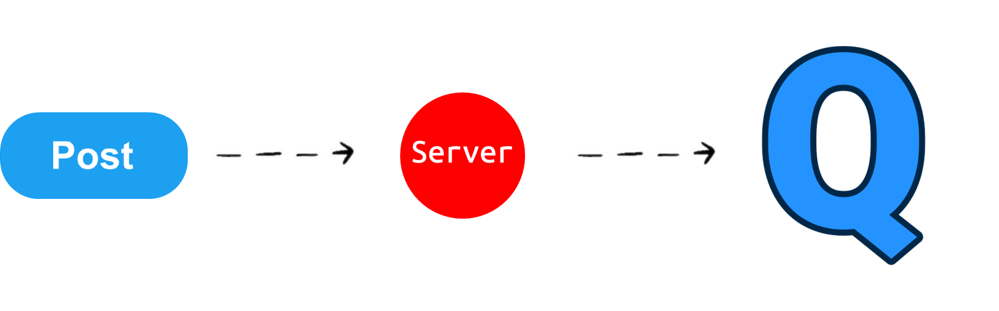

But we have another problem. What happens when someone wants to find a specific tweet? If STORAGE Q contains millions or even billions of tweets, the server cannot simply look through every single one of them until it finds the one we are looking for. That would be extremely inefficient.

So, we need a way to organize the data and retrieve exactly what we need without searching through everything. Suppose that **“W MACHINE”** is responsible for handling this need. Whenever a user requests a post — or, in our case, requests their homepage timeline — **W MACHINE retrieves the required data from STORAGE Q and sends it back to the server.** 

But is this really enough?

Our W MACHINE can retrieve the data we need, but what happens when the amount of data becomes enormous? Searching and retrieving data from a storagecomes with a cost. As the amount of data grows, our W MACHINE can become slower, and a system that works perfectly with a small amount of data may struggle when it has to handle millions or billions of records.

And it is not our only concern.

What happens when millions of users start sending requests at the same time? What if these users are located all around the world? Can a single server handle all of these requests? Can a single W MACHINE retrieve everything they need fast enough?

And perhaps the most important question: **what happens if our server or W MACHINE goes down?**

If our entire system depends on a single server and a single W MACHINE, one failure could make the whole system unavailable. For a system like Twitter, where users expect to access the service at any time, this could be a disaster.

So, our simple scheme:

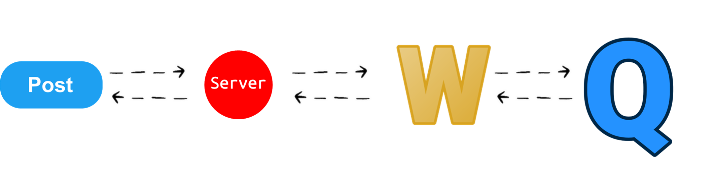

is starting to look far too simple.

We need to distribute the workload, handle failures, control incoming traffic, serve users from different parts of the world, and scale the system as the number of users grows.

And this is where things start to get interesting.

### Clusters of Servers and How Do We Manage Them?

We have already seen why relying on a single server is not enough. Instead, we can use multiple servers and group them together to handle the workload. This group of servers working together is called a **server cluster**.

But what does a server cluster actually look like?

Imagine that instead of having one server responsible for everything, we have multiple groups of servers, each handling a different or same responsibility. Some servers might handle incoming API requests, others might work with STORAGE Q, while others might handle background tasks.

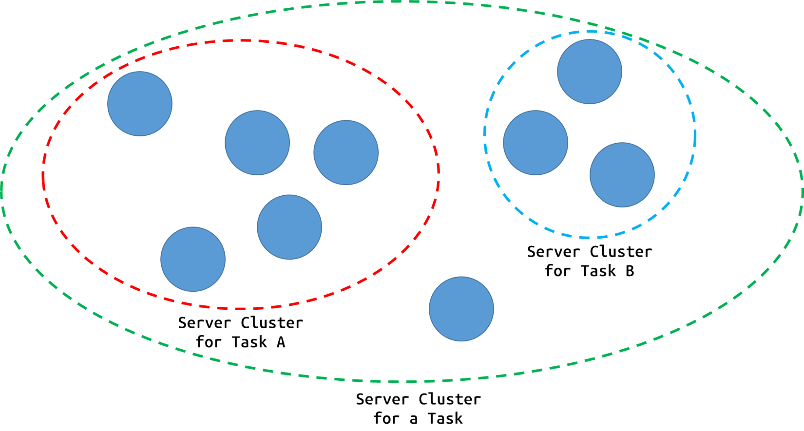

Now we have multiple servers working together instead of relying on a single machine. But this brings us to a new set of questions.

How do these servers communicate with each other? How does a server know which other server it should send a request to? If there are multiple servers capable of handling the same task, how do we decide which one should be responsible for a request? And what happens when one of these servers goes down?

We now need a way to manage these machines, distribute the workload between them, and make sure that every request reaches the right place. So, how do we actually manage clusters of servers?

#### Proxy, Load Balancing

As you can see in the title, there are some cool names for the different technologies we can use to solve these problems. So, let's start with **proxies**.
Suppose we have a server with the IP address x`xx.x.xxx.xx`. From a client, we can simply send an HTTP request to it using `curl`:

```jsx
curl http://xxx.x.xxx.xx/ip
```

The terminal might show something like:

```jsx
{ "origin": "85.105.xx.xx" }
```

This is the public IP address visible to the target server. In a direct connection, the target server can see the public IP address our request is coming from.

Now, let's put a **proxy** between us and the target server.

A proxy acts like a messenger that sends the request to the target server on our behalf, receives the response, and brings it back to us.

We can tell `curl` to use a proxy by adding the `-x` parameter:

```
curl -x http://proxy-server-ip:8080 http://xxx.x.xxx.xx/ip
```

The response might look like this:

```
{
  "origin": "198.51.xxx.xx"
}
```

So, what changed?

Previously, we were connecting directly to the server. The server could see our actual IP address:

```
CLIENT 85.105.xx.xx → SERVER
```

Now, the connection looks more like this:

```
CLIENT 85.105.xx.xx → PROXY 198.51.xxx.xx → SERVER
```

The target server no longer sees our client IP as the direct source of the connection. Instead, it sees the proxy's IP address. This is one of the main reasons why proxies are useful. They can act as an intermediary between clients and the servers they want to communicate with.

A proxy can be used to:

- **Hide the client's IP address from the target server.**
- **Control or filter outgoing traffic**, such as in a company's internal network.
- **Route traffic through a specific location or network**, which can sometimes be useful for accessing geographically restricted services.

So far, we have been using a proxy on the **client side**. The client decides to send its request through the proxy, and the proxy communicates with the target server on the client's behalf.

But let's return to our Twitter system.

Imagine that we have hundreds or thousands of servers behind our system. Do we really want every client on the internet to connect directly to those servers?

Probably not. 

We would rather have a single entry point in front of our servers that receives incoming requests and decides where each request should go. In other words, we want to reverse the direction of what we just did. And this is where **reverse proxies** come into the picture. Let's start with a very simple example:

```
events {}

http {
    upstream nodejs_backend {
        server xxx.xx.xxx.xx:3000;
    }

    server {
        listen 8081;

        location / {
            proxy_set_header Host $host;
            proxy_set_header X-Real-IP $remote_addr;
            proxy_set_header X-Forwarded-For $proxy_add_x_forwarded_for;

            proxy_pass http://nodejs_backend;
        }
    }
}
```

Before looking at what each line does, let's take a step back and understand what we are looking at. This is a configuration file for tool named Nginx. **Nginx** is a web server that can also work as a reverse proxy and several other things. We don't need to know all of its capabilities right now. For our purposes, we can simply think of it as a program that sits between our clients and our backend servers. Now, let's break down the important parts of our configuration.

First, we define our backend server:

```
upstream nodejs_backend {
    server xxx.xx.xxx.xx:3000;
}
```

This tells Nginx where our actual application server is running.

Then we tell Nginx to listen for incoming requests on port `8081`:

```
server {
    listen 8081;
```

Inside the `location` block, we tell Nginx what to do with incoming requests:

```
location / {
    proxy_pass http://nodejs_backend;
}
```

This is the important part. Whenever a request reaches Nginx, it forwards that request to our `nodejs_backend`.

The other lines:

```
proxy_set_header Host $host;
proxy_set_header X-Real-IP $remote_addr;
proxy_set_header X-Forwarded-For $proxy_add_x_forwarded_for;
```

allow us to pass information about the original request to the backend server, such as the host and the client's IP address.

So, what does our system look like now?

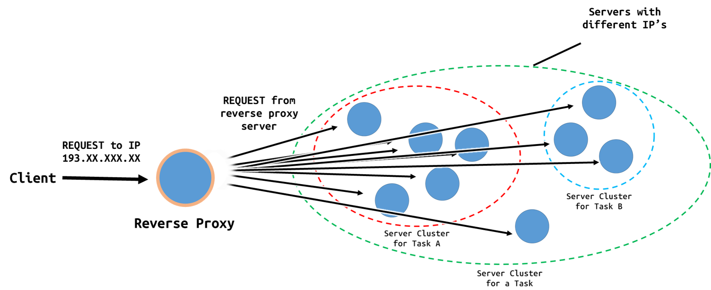

From the client's perspective, Nginx is now the server it communicates with. But from Nginx's perspective, there is another server behind it that actually handles the request. And this is the basic idea behind a **reverse proxy**. The key difference from the proxy we saw before is which side the proxy represents.

But why would we want to do this?

Right now, we only have one backend server. That doesn't seem very useful. However, remember the problem we had earlier: **what happens when one server is not enough? What if we have multiple servers handling the same task?** Now Nginx can become the single entry point for all of these servers.

And this brings us to our next problem: **How should Nginx decide which server should handle each request?**

By adding new servers in to the code as you see below:

```jsx
upstream nodejs_backend {
        server xxx.xx.xxx.xx:3000;
        server xxx.xx.xxx.x1:3000;
        server xxx.xx.xxx.x2:3000;
}
```

we tell Nginx to choose one of the servers in this group for each incoming request, using a specified load-balancing method.

However, not every server is always available or suitable for handling a particular request. For example, Server 0 might be unable to serve Request X because:

- It is overloaded with too many requests, causing its response time to increase or even making it crash.
- Its network connection is lost, making it unreachable.
- It is not configured to handle Request X, or it does not have the necessary resources to process it.

In such cases, Nginx should route Request X to another suitable server instead of Server 0.

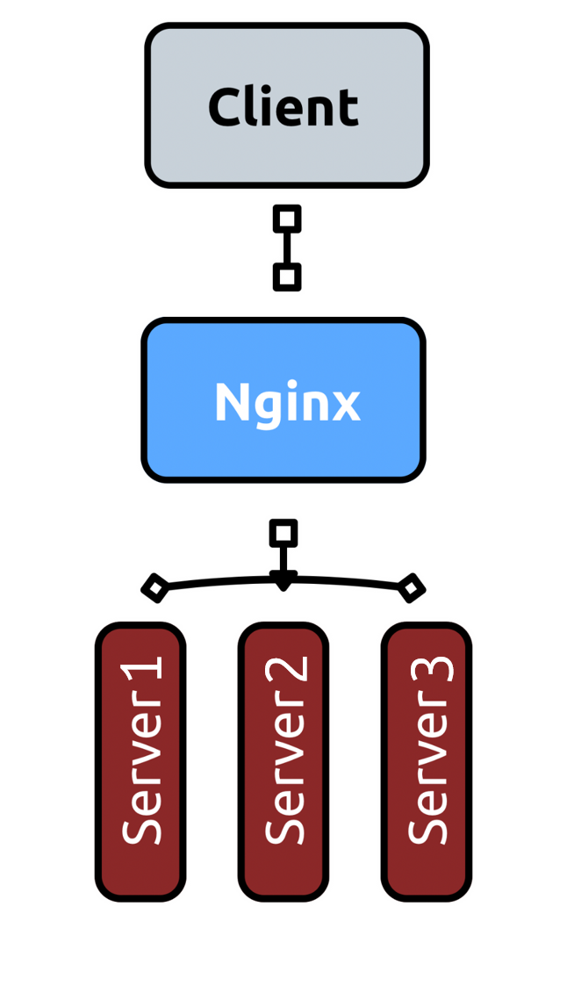

When we apply an algorithm into that, the server selection may be more clever. I mentioned that Nginx choose one of the servers in the cluster using a specific load-balancing method, we decide to apply which algorithm the system requires. To make an intoduction, you can see one of the simpliest one among them, Round Robin method.

The idea is straightforward. The first request goes to Server 1, the second goes to Server 2, and the third goes to Server 3. When the next request arrives, we start over from Server 1. We continue this cycle as new requests come in, distributing them across our servers in a predictable order.

Of course, this approach assumes that our servers can handle a similar amount of work. Round Robin does not automatically measure their current workloads or response times. It simply distributes requests in a predefined sequence. Nevertheless, it provides a simple way to prevent every request from being directed to the same server.

And we do not necessarily have to implement this mechanism ourselves.

**That's exactly what Nginx does by default when we apply our current configuration file.** Remember the `upstream nodejs_backend` block we defined earlier? By listing our backend servers inside it, we allow Nginx to distribute requests between those servers using its default Round Robin method.

But what if we want to understand how this algorithm actually works? For example, imagine that we are developing our own load balancer as a .NET developer and want to implement a Round Robin method in C#. We are not using Nginx here; we are implementing the algorithm ourselves to understand its logic.

Of course, the same idea can be implemented in other environments, such as Node.js. Remember, this tutorial aims to give you a broad understanding of system design so that, once you understand the system and its needs, you can choose the technologies and tools you want to work with.

```csharp
using System.Threading;

// Some configurations...

var servers = new[]
{
    "http://xxx.xx.xxx.xx:3000",
    "http://xxx.xx.xxx.x2:3000",
    "http://xxx.xx.xxx.x3:3000"
};

var selector = new RoundRobinSelector(servers.Length);

// For each incoming request...
var selectedServer = servers[selector.SelectServer()];

// Forward the request to the selected server
// and return its response to the client.

public sealed class RoundRobinSelector
{
    private readonly int _serverCount;
    private int _currentIndex = -1;

    public RoundRobinSelector(int serverCount)
    {
        _serverCount = serverCount;
    }

    public int SelectServer()
    {
        int index = Interlocked.Increment(ref _currentIndex);
        return (int)((uint)index % (uint)_serverCount);
    }
}
```

The most important part of our code is the `SelectServer()` method. Whenever a request arrives, we call this method to determine which backend server should handle it. The selected server's address is then used to forward the HTTP request to that server, and its response is returned to the client.

Let's take a closer look at the algorithm:

```csharp
int index = Interlocked.Increment(ref _currentIndex);
index = (int)((uint)index % (uint)_servers.Length);

return _servers[index];
```

First, we increment `_currentIndex` using `Interlocked.Increment`. Since multiple requests may arrive at the same time, this operation ensures that the index is updated atomically.

Next, we use the modulo operator (`%`) to keep the index within the bounds of our server array. For example, if we have three servers, the selected indexes cycle through `0, 1, 2, 0, 1, 2...`. Once we reach the end of the array, the index returns to zero, allowing us to start the cycle again.

And that's the fundamental idea behind Round Robin. We select a server, move to the next one, and repeat the process for every incoming request. Our selection algorithm takes constant time, or O(1), because we do not need to search through the entire server list to find the next server. Of course, this example does not automatically detect unavailable servers or measure their current workloads. It simply selects the next server in the sequence.

> By adding more attributes or using different algorithmic approaches, you can take each server’s capacity and availability into account. You can research the **Weighted Round Robin Algorithm** to level up.
> 

### Hashing

If you want to achieve even better performance, you should become familiar with another important concept in load balancing: **hashing-based load balancing**. But what exactly is hashing here? You can look up its literal meaning; I will teach you how it works through an example.

First, let’s build up to it. Assume that there is some data I can access on a server, and that this data can be continuously modified. For example, the amount of money in my bank account. Every time I send a request to the server, I may need to retrieve that data from where it is stored, perform operations such as adding or subtracting an amount, and save the updated value.

If I have to repeat this process millions of times, it can put an unnecessary load on the server. This is where modern systems use a technique for that. At a basic level, the idea of the technique is to temporarily store data or information that can help the server process repeated requests more quickly, rather than having to perform the same operations from scratch every time.

We will cover this topic in much greater detail when we get to **caching**. For now, all you need to know is that a server can temporarily store information related to a client's request and use that information to speed up subsequent operations.

Now, let’s move on to hashing.

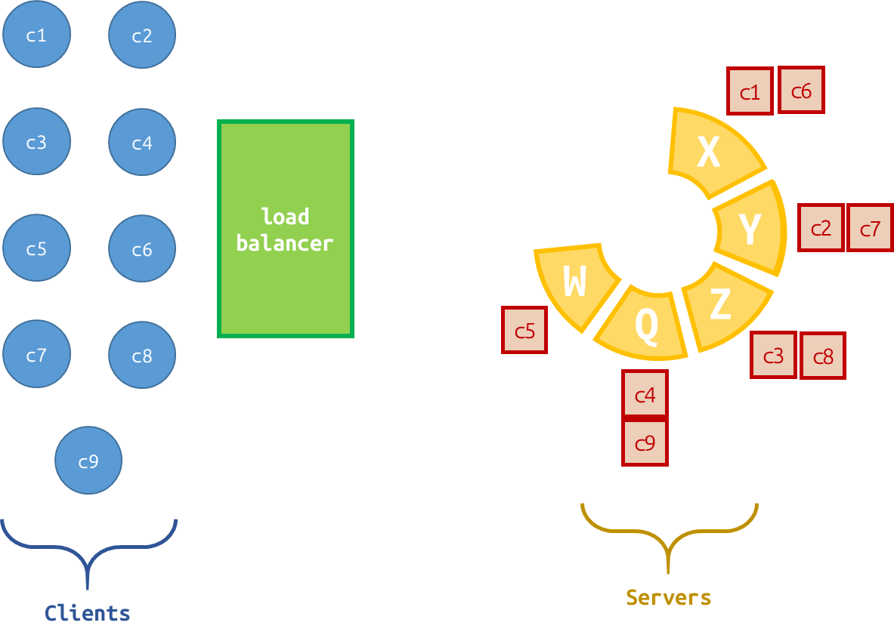

The load balancer in the diagram distributes clients across the servers using the **Round Robin** method. According to this method, each incoming request is forwarded to the next server in the sequence. So, when client C1 wants to update its bank account balance again, our load balancer will forward its request to the next server, W. However, as we discussed in our buildup, the information related to C1's previous request was stored on server X.

As you can see, if we want to speed things up by temporarily storing information related to requests, a load balancer that distributes requests without considering which client they belong to may not be the best choice. In this scenario, we need our load balancer to determine which server a particular client should be directed to, so that subsequent requests from that client can reach the same server.

So, would it make sense to use a separate storage system to keep track of which client was assigned to which server? Not really. We would introduce another component that needs to be accessed and maintained. The load balancer would have to look up this information for every request, adding extra overhead and potentially creating another bottleneck. We would be solving one performance problem by introducing another.

So, what should we do instead? What if we could run a mathematical calculation based on the client's ID, name, or even the type of request, and use the result to determine which server should handle it?

In our example, we have nine clients, C1 through C9, and five servers: X, Y, Z, Q, and W. We can use a hash function to convert a client's identifier into a numerical value and then map that value to one of our servers.

For a simple example, let's use the client's numerical ID as the input to our calculation. We can calculate the remainder when the ID is divided by the number of servers:

`Server Index = Client ID % 5`

Since we have five servers, the result will be one of five possible values: 0, 1, 2, 3, or 4. We can map these values to our servers in order: 0 to X, 1 to Y, 2 to Z, 3 to Q, and 4 to W.

For example, C1 will always be directed to Y because 1 % 5 = 1. Similarly, C6 will also be directed to Y because 6 % 5 = 1. As long as the client ID, server list, and mapping rules remain unchanged, the same client will be directed to the same server without requiring a separate storage system to remember the assignment.

Of course, this is a simplified example. In a real-world system, we would need to consider what happens when a server becomes unavailable or when we add new servers. We will get to that shortly. Now, let's take a quick look at some popular hashing approaches and the different ways we can choose what to hash.

Some well-known hash functions include **SHA-256**, **MurmurHash**, and **xxHash**. However, they serve different purposes. SHA-256 is a cryptographic hash function, while MurmurHash and xxHash are designed for fast, non-cryptographic hashing. For load balancing, we generally care about speed and a consistent distribution of requests rather than cryptographic security.

We can also choose different inputs for our hashing process. For example, **client-based hashing** uses a client identifier, session ID, or IP address to help direct requests from the same client to the same server. **Request-based hashing** uses information such as a URL, request path, or selected request parameters to determine the destination. **Content-based hashing** uses a particular data key, such as a user ID or account ID, to route requests involving the same data to the same server.

The right choice depends on what we want to keep together and how our system is designed. In our example, client-based hashing helps us direct repeated requests from the same client to the same server. But remember: **hashing does not automatically make data persistent, guarantee that it is cached, or ensure that a server is always available.** It simply gives us a way to determine the destination using a calculation instead of looking up a stored client-to-server assignment.

### Leader Election

While a cluster of servers takes part in our system, we may face some problems. For example, you are sending a request to update a specific integer value in storage by adding +1 to it. You send **REQUEST A** to a load balancer, and it routes the request to **SERVER X**. At the same time, another user sends **REQUEST B**, which is routed to **SERVER Y**. Both servers read the current value as 10 and try to increase it by 1. SERVER X writes 11 to storage, and SERVER Y does the same. The final value remains 11 instead of 12 because one of the updates has been lost.

To avoid such problems, we can use Leader Election to select a server that coordinates these operations. Instead of handling the updates independently, the other servers can forward them to the leader when coordination is needed. This way, the operations can be processed in the correct order.

Now, let's consider another scenario. Our system sends thousands of emails every hour, and we have multiple servers running the same background scheduler to handle these tasks. At 10:00 AM, each server checks the task queue and sees that an email campaign needs to be sent. SERVER X starts sending the emails, but SERVER Y and SERVER Z also detect the same task and start sending them independently. As a result, users may receive the same email multiple times.

We can use Leader Election to select one server to coordinate the scheduling process. The leader checks the task queue and initiates the campaign, while the other servers remain available to handle different tasks. If the leader crashes, the remaining servers can elect a new leader to take over its responsibilities. However, we still need to make sure that a task already in progress is not initiated again after a leader change.

We can apply the same idea to scheduled maintenance. Suppose our system has ten servers, and we need to clean up expired files every night. If every server runs the same maintenance process at midnight, all ten servers may attempt to delete the same files simultaneously. This creates unnecessary work and puts additional load on our system. Instead, we can elect one leader to coordinate the cleanup process while the other servers continue handling regular requests. If the leader goes down, another server can take over, allowing the maintenance process to continue without relying permanently on a single server.

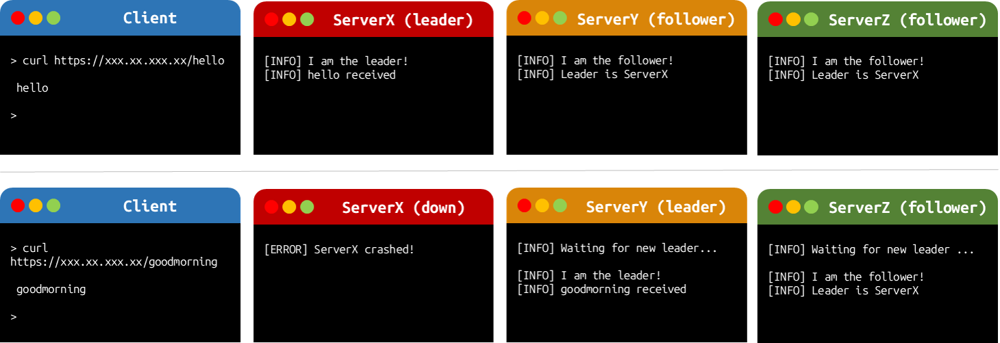

The basic process of Leader Election starts when the servers realize that there is no available leader. They communicate with each other to determine who should take responsibility, following a set of rules to select a leader. Once the election is completed, the remaining servers become followers and monitor the leader's availability. But how do they know whether the leader is still alive?

The leader periodically sends small messages to the other servers to let them know that it is still running. If a follower fails to receive a heartbeat within a predefined timeout, it assumes that the leader may have crashed and starts a new election. Once a new leader is selected, the process continues. This is a fundemental process of leader election. 

There are different approaches to handling this process, each with its own rules for selecting a leader. Let's take a look at one of the simpler ones: the **Bully Algorithm**. In the Bully Algorithm, every server has a unique ID, and the server with the highest ID among the functioning servers has priority to become the leader. When a server detects that the current leader is unavailable, it sends an `ELECTION` message to all servers with higher IDs. If a higher-ID server responds with an `OK` message, it takes responsibility for continuing the election. If no higher-ID server responds within the timeout, the initiating server declares itself the new leader and broadcasts a `COORDINATOR` message to notify the others. If a higher-ID server comes back online later, it may initiate another election and reclaim leadership.

```jsx
onHeartbeatTimeout():
    startElection()

startElection():
    send ELECTION to all servers with higher IDs

    if no higher-ID server responds:
        becomeLeader()
        broadcast COORDINATOR
    else:
        wait for the higher-ID server to finish election
```

### Rate Limiting

Let’s travel back in time to September 1996. The commercial internet was still young. In New York City, one of the oldest and largest Internet Service Providers was a company called Panix. They hosted emails, websites, and provided internet access to thousands of people. Then, on September 6, Panix suddenly vanished from the internet. The hardware was fine. No data was stolen. Instead, their servers were completely paralyzed by something the internet had never seen on this scale before: a **Denial of Service (DoS) attack**.

Remember the **3-Way Handshake** (SYN, SYN-ACK, ACK) we talked about earlier? The attacker exploited it. They flooded Panix's servers with thousands of **SYN** messages. The servers replied with **SYN-ACK** and reserved a little bit of memory while waiting for the final **ACK**. Because the IP addresses were fake, that final **ACK** never came. The servers stood there, holding thousands of connections open, waiting for clients that didn't exist. Within seconds, they ran out of memory, completely locking out legitimate users.

This was the infamous **SYN Flood Attack.**

To protect our servers, we need a bouncer at the front door. We need a mechanism that says: *"You are allowed to make X requests per minute. If you make X + 1, I am going to ignore you.".* This concept is called **Rate Limiting**.

When a client hits this limit, our server immediately cuts them off and returns a specific HTTP response: **429 Too Many Requests**. If you have ever refreshed a webpage too many times and been locked out for a few minutes, you have just met a rate limiter.

If you only have one server, rate limiting is straightforward. You can simply keep a hash table or dictionary right in the server's RAM to count how many requests each IP address has made. But remember, we have a cluster of servers now. Imagine our load balancer uses Round Robin. A user sends their first 50 requests to Server 1. Server 1 hits the limit and says, 'Stop.' But what happens when the user's 51st request gets routed to Server 2? Server 2 has its own isolated RAM. It looks at its own empty hash table, thinks this is the user's very first request, and lets them in! Because our servers don't share RAM, the rate limit is broken. To fix this, we need a centralized, lightning-fast storage system that all our servers can read from and write to at the same time. This is exactly what **Redis** is built for.

```jsx
const express = require('express');
const { createClient } = require('redis');

const app = express();
const redisClient = createClient();

// Connect our Node server to the Redis storage
await redisClient.connect();

const rateLimiterMiddleware = async (req, res, next) => {
    const userIdentifier = req.ip; // IP address to identify users

    const MAX_REQUESTS = 5; 
    const WINDOW_SECONDS = 10;
 
    const currentRequestCount = await redisClient.incr(userIdentifier);

    if (currentRequestCount === 1) {
        await redisClient.expire(userIdentifier, WINDOW_SECONDS);
    }

    if (currentRequestCount > MAX_REQUESTS) {
        return res.status(429).json({ error: 'Too Many Requests' });
    }

    next();
};

// Apply our rate limiter to a specific route
app.get('/api/secure-data', rateLimiterMiddleware, (req, res) => {
    res.json({ success: true });
});
```

Let’s see how we implement a centralized rate limiter using Node.js, Express, and Redis.

```jsx
const MAX_REQUESTS = 5;
const WINDOW_SECONDS = 10;
```

This is the rule our bouncer enforces. We are telling our system: *"A single IP address is allowed to make a maximum of 5 requests every 10 seconds."*

const currentRequestCount = await redisClient.incr(userIdentifier);

Here, we ask Redis to increment (incr) the count for this user's IP address. Redis is remarkably smart. If this IP address does not exist in Redis yet, it automatically creates a new record and sets the count to 1. If the record already exists, it simply adds 1 to the current number.

```jsx
if (currentRequestCount > MAX_REQUESTS) {
    return res.status(429).json({ error: 'Too Many Requests' });
}
```

If the user's request count hits 6 within that 10-second window, this if statement catches them. The server immediately returns the **429 Too Many Requests** error, and the process stops. The next() function is never called, so the user never reaches our database or our internal application logic. With this setup, it doesn't matter if we have one Node.js server or a hundred of them. Every server connects to the exact same Redis instance, ensuring our rate limit is perfectly enforced across our entire Twitter system!

> As I mentioned, rate limiting prevents DoS attacks. However, if the attacker routes requests from thousands of different machines by using them as a **botnet** (or as **proxies**), this is known as a DDoS attack. If we want to prevent it, we must use Web Application Firewalls like Cloudflare and some security services. Rate limiters themselves are not capable of stopping this type of huge attack.
> 

Before diving into the fun part —designing every parts of your system—, you should put a little more knowledge about availability in your pocket. We'll explore some fault-tolerance mechanisms and hashing algorithms along the way.

### CDN

Imagine that our Twitter system is running on servers located in the United States. A user in the same region might be able to communicate with those servers relatively quickly. But what happens when someone from Europe or Asia wants to access the same system?

The data still has to travel across the world. Of course, the internet is fast. But it is not instantaneous. Data travels through fiber-optic cables at roughly 200,000 kilometers per second, and the actual route between two locations is not necessarily the shortest one. Communication across continents can introduce tens or even hundreds of milliseconds of network latency, while communication within the same local region may take only a few milliseconds. That difference might not sound like much. But when millions of users interact with a system, these delays can affect the overall experience. So, how can we bring parts of our system closer to our users?

A CDN (*Content Delivery Networks*) is a distributed network of servers that helps deliver content from locations closer to the users requesting it. Instead of making every request travel back to a central location, a CDN can serve suitable content through its geographically distributed infrastructure.


This becomes especially useful for a global platform like Twitter, where users from different continents interact with the same service. A CDN can reduce delivery delays and help reduce the amount of traffic that needs to reach the central infrastructure. 

## Enhanced Availability

System of Twitter requires high availability. But how much? The answer to this question introduces us advanced cost considerations. Before deciding how much money we should spend on our infrastructure, we need to understand what availability actually means in numbers. In system design, we commonly use a concept called **the nines of availability** to express our availability targets. The more nines we add, the less downtime we can tolerate. Let's see what these numbers mean in practice. Let's see what these numbers mean in practice.

| Availability | Common Name | Maximum Downtime per Year |
| --- | --- | --- |
| 99% | Two nines | 3 days, 15 hours |
| 99.9% | Three nines | 8 hours, 46 minutes |
| 99.95% | Three and a half nines | 4 hours, 23 minutes |
| 99.99% | Four nines | 52 minutes, 34 seconds |
| 99.999% | Five nines | 5 minutes, 15 seconds |
| 99.9999% | Six nines | 31.5 seconds |

*These figures assume a 365-day year and count all downtime against the availability target.* [Source: AWS reliability documentation](https://docs.aws.amazon.com/whitepapers/latest/hybrid-connectivity/reliability.html)

Now, think about the difference between 99.9% and 99.99%. That extra nine reduces the annual downtime from approximately 8 hours and 46 minutes to just 52 minutes. Sounds great, doesn't it? But achieving this kind of improvement can significantly increase infrastructure costs, as maintaining redundancy, expanding capacity, and implementing more sophisticated failure recovery mechanisms require additional resources.

So, what would be the optimal availability target for Twitter? Considering its global user base and the expectation that users should be able to post tweets and refresh their timelines at any time, let's aim for **99.99% availability**, also known as four nines. This means our system can tolerate approximately **52 minutes of downtime per year**. Sounds reasonable, doesn't it? Of course, this is our design target, not a claim about Twitter's actual availability.

### Scaling the System, Horizontal/Vertical Scaling

Assume that you have designed the system and brought it to market. But its capacity does not meet the demand, you need to improve it. What should you do? The first thing you might consider is increasing the capacity of your existing server. What if you could give it more CPU power, more RAM, or faster storage?

This approach is called **vertical scaling**. For example, let's assume that your application is running on a server with 4 CPU cores and 8 GB of RAM. As the number of users increases, your server starts struggling to handle the incoming requests. You can upgrade it to 16 CPU cores and 32 GB of RAM to handle more requests simultaneously.

Sounds simple, doesn't it? You don't need to distribute your application across multiple servers or deal with the complexity of coordinating them. You just increase the resources of the machine you already have. But there is a catch. **A single machine has physical and practical limits.** Even if you add more CPU cores and RAM, your system may still struggle with the speed at which it can read and write data. Every storage device has its own I/O limits, and as the number of incoming requests increases, these operations can become a bottleneck. At some point, upgrading your hardware further becomes either impossible or too expensive. At some point, you can no longer increase its resources, or the cost of doing so becomes unreasonable. And even if you have the most powerful server available, it can still become a single point of failure.

So, vertical scaling can help us handle increasing demand, but is it enough to achieve our availability target of 99.99%? Let's explore another approach. Instead of making one server more powerful, what if we added more servers to our system?

This is called **horizontal scaling**. Imagine that our server is struggling to handle all incoming requests. Instead of upgrading its CPU, RAM, and storage, we introduce additional servers to share the workload. Each server can handle a portion of the incoming requests, allowing our system to serve more users simultaneously. As we discussed in the load balancing section, you can configure your load balancer to distribute incoming requests among multiple servers by specifying their IP addresses. When you need more capacity, you can simply add another server to the pool and update the configuration.

Sounds like you have solved your problem, right? Well, not quite. **What happens when the number of servers changes?**

As we discussed in the hashing-based load balancing section, we can use a client's ID and a hash function to determine which server should handle its requests. You can go back to that section to see an example of how clients are distributed among servers. Now, let's assume that you add a new server, E, to the cluster.

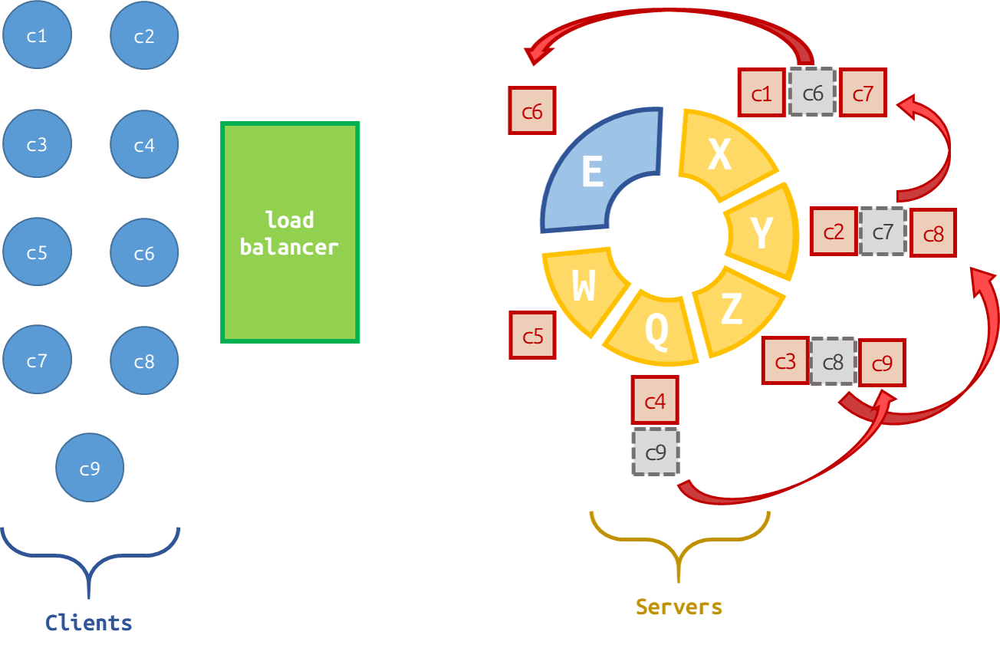

Since our simple hashing strategy uses the number of servers to determine the destination, adding a new server changes the calculation for many clients. As a result, requests that were previously directed to one server may now be sent to another. This can disrupt user sessions or require data to be transferred between servers.

So, although horizontal scaling allows us to increase capacity by adding more servers, we need a way to minimize the impact of changes in our server pool. **Can we distribute clients among servers in a way that requires fewer clients to be reassigned whenever we add or remove a server?** This is where **consistent hashing** comes into play.

Instead of using a linear index to distribute clients among servers, consistent hashing uses a circular address space called a **hash ring**. Imagine that all possible outputs of your hash function, from (0) to (2^{32}-1), are placed on a circle, with both ends connected. Let's see how it works in our example. First, your load balancer hashes the identifiers of the servers (X, Y, Z, Q, and W) and places them on the ring. Then, it does the same for our clients, from C1 to C9. To determine which server handles a client's request, we start from the client's position and move clockwise until we find the first server. That server becomes the destination for the client.

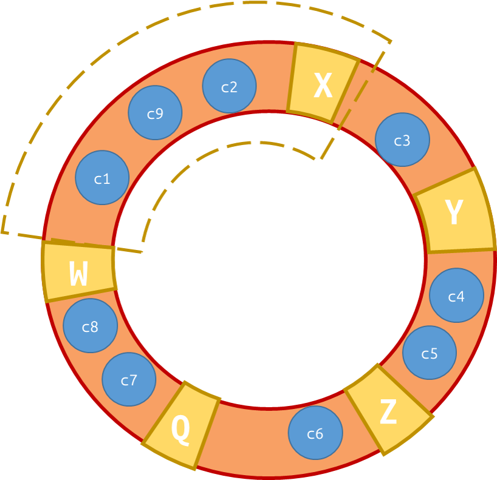

In our example, C1, C2 and C9 are assigned to X, C3 to Y, C4 and C5 to Z, C6 to Q, and C7 and C8 to W. But what happens when you add a new server? Let's say we introduce server E to handle the increasing load.

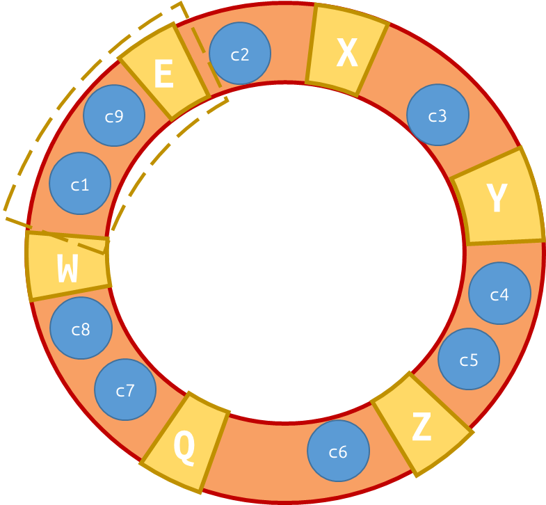

Now, C1 and C9 assigned to E but the other ones remain same. Unlike our simple modulo-based approach, we don't need to recalculate the assignments for all clients. The existing clients and servers keep their positions on the ring, and only the clients whose assignments are affected by the new server need to be reassigned. **That's the main advantage of consistent hashing:** when you add or remove servers, you minimize the number of clients that need to be reassigned. This can help reduce cache misses, unnecessary data movement, and extra workload.

> The main idea here is that, when designing a system, you should always keep scalability and future growth in mind.
> 

### Today’s Technologies

So far, we have discussed several design elements that help us build scalable and highly available systems. But how do we implement these ideas in real-world applications? Let's take a quick look at some of the technologies used today.

For example, **NGINX, HAProxy, and Envoy** can be used as load balancers to distribute incoming requests among multiple servers. Depending on your needs, you can configure different strategies, such as Round Robin, and apply rate limiting to prevent a single client from overwhelming your system. Envoy and NGINX also provide features that help control incoming traffic.

We also talked about leader election. In distributed systems, tools such as **etcd and Apache ZooKeeper** can help coordinate processes and maintain shared state, making them useful building blocks for leader election and coordination. However, the exact algorithm and implementation depend on the system you are designing.

What about serving users from different parts of the world? Services such as Cloudflare, Amazon CloudFront, and Akamai distribute content through geographically distributed servers, allowing users to retrieve some content from locations closer to them instead of always reaching your origin server.

And what about horizontal scaling? **Docker and Kubernetes** are widely used to package, deploy, and manage applications across multiple machines. Kubernetes can also help scale application replicas and replace unhealthy instances, while its service discovery and traffic-routing mechanisms help applications communicate within a cluster.

> Of course, these are only a few examples. Technologies such as these often work together, but you do not necessarily need all of them in every system. **The important part is understanding the problem you are trying to solve before choosing the technology.** Once you understand the design requirements, you can decide which tools fit your system, rather than trying to fit your system around a particular tool.
> 

## API Functions

Hello, welcome to the fun part, learner! We are going to design some of the functionalities that Twitter supports. These functionalities play a **key role in guiding our system design**. To get started, we need to create a **rough blueprint** of some of these functions. This will help us understand what kind of data our servers expect from clients, how we should process it efficiently, and what kind of data our clients will receive in return. With this information, we can start designing our database, the functional components of our system, and a **general blueprint** of the overall architecture.

Before moving on, do you know what an **API (Application Programming Interface)** is? Think of an API as a bridge that allows two software components to communicate with each other. It defines what you can ask a system to do, what information you need to provide, and what kind of response you can expect in return.

Let's imagine that we are designing a car management system. We want to retrieve information about a specific car. Our client could use a function like this:

```
function getCar(carID) {
  return httpClient.get(`/v1/cars/${carID}`);
}
```

When this function is called with `getCar(12)`, it sends the following HTTP request:

```
GET /v1/cars/12
```

The server processes the request, retrieves the corresponding car information from its database, and returns a response like this:

```
HTTP/1.1 200 OK
Content-Type: application/json

{
  "carID": 12,
  "carName": "Mustang",
  "engineID": "V8",
  "modelYear": 2024
}

```

Notice that the client doesn't need to know how the server stores or retrieves the car information. It only needs to know how to call the API and what kind of response to expect. As we design Twitter, we will follow the same approach for functionalities such as creating a tweet or retrieving a user's home timeline. We will define what information the client needs to send, how the server should process the request, and what data the client will receive in return.

Let’s start with our first functionality: posting a tweet. We could simply name it `postTweet()`. As you can see, the function takes parameters between its parentheses, assuming you have some knowledge of scripting.

Now, let’s focus on the `postTweet()` function. When we press the POST button, we have some text that we want to publish, right? The function must receive this text as a parameter so that the server knows what to store. Otherwise, how would the server know what we want to post? Once the tweet is stored, the client can retrieve it later through a GET request when fetching the home timeline. If we don't send the text when creating the tweet, the server has no content to store and return to other users.

Then, assume that the server took the text we sent and processed it, but does not know who sent it. Could we obtain this information automatically from the request's default network headers, like an IP address or device info? No, because a unique user can make API calls from different devices or different internet connections. Furthermore, it would not be secure, **as multiple people on the same Wi-Fi share the same IP address, and attackers can easily fake (spoof) these default headers to impersonate someone else.** So then, what should we do to solve this problem? We store all users in our database!

For example, assume that a user named Elon signed up to Twitter. The system stores Elon’s data —which we will talk about in the database part in more detail— in its storage. Every `postTweet()` API call that Elon makes must be matched with his stored data in kind of a format like `user: "Elon", text: "Hello, this is my first post."` But in the real world, there are tens of thousands of Elons living currently who are able to sign up for Twitter. How could we tell our Elon apart from the others? We assign him a unique `userID` made of numbers, letters, and characters. And each time Elon calls the `postTweet()` API function, he sends his `userID` too in the HTTP body. Then we process it and store the data in kind of a format like `userID: "2R9geR6b007", text: "Hello, this is my first post."` In the light of that, we pass `userID` as a parameter in `postTweet(userID, text)`.

Let’s move on to timeline part. If you could followed me, you can predict that we will create that functionality as naming the API call `getTimeline()` . Once people start posting tweets, we need a way to see them on our main screen—what we call the home timeline, right? So, what parameters should we pass between the parentheses of `getTimeline()`?

Think about it: when Elon opens his Twitter app, does he want to see random tweets from strangers all over the world, or does he want to see tweets from the specific people he follows? Of course, he wants to see his own personalized feed! For the server to know whose timeline to prepare and return, we need to tell the server who is asking. In the light of that, we simply pass `userID` as a parameter again: `getTimeline(userID)`. Since we are not storing anything new on the server and only reading existing data, this function will make an HTTP GET request instead of a POST request.

Now that we have decided on our two core functions and their parameters, let’s put everything together and see how `postTweet()` and `getTimeline()` actually look in code, what kind of HTTP requests they trigger, and what the server sends back to us in return!

When our user Elon (`userID: "2R9geR6b007"`) writes a tweet and hits the publish button, our client calls the following function:

```
function postTweet(userID, text){
  const payload = {
    userID: userID,
    text: text
  };
  return httpClient.post('/v1/tweets', payload);
}
```

When this function is called with `postTweet("2R9geR6b007", "Hello, this is my first post.")`, it packages our parameters into the body and sends the following HTTP POST request to the server:

```
POST /v1/tweets
Content-Type: application/json

{
  "userID": "2R9geR6b007",
  "text": "Hello, this is my first post."
}
```

The server takes this request, stores Elon's new tweet in its database, and returns a response like this to confirm everything went smoothly:

```
HTTP/1.1 201 Created
Content-Type:application/json

{
  tweet information as JSON
}
```

*(Notice the `201 Created` status code! Unlike `200 OK` which just means "success", `201` specifically tells the client that a brand-new resource was successfully created and stored on the server.)*

Now, let's say Elon wants to refresh his home page and read some tweets from the people he follows (for example, Denise and Otto). Our client calls the `getTimeline()` function:

```
function getTimeline(userID){
  return httpClient.get(`/v1/timeline?userID=${userID}`);
}
```

When this function is called with `getTimeline("2R9geR6b007")`, notice that there is no request body because we are not uploading any content. Instead, we attach Elon's `userID` right at the end of the URL and send the following HTTP GET request:

```
GET /v1/timeline?userID=2R9geR6b007
```

The server receives this request, checks who `2R9geR6b007` is following in the database, gathers their latest tweets, and returns a list of tweets in a response like this:

```
HTTP/1.1 200 OK
Content-Type:application/json

{
  "timeline": [
    list of tweets information as JSON
  ]
}
```

And just like that, the client takes this JSON list and renders the tweets on Elon's screen!

> We will come back to these functions as we continue designing, because new architectural changes in our system will require us to refactor the structure of these requests.
> 

## Creating the Database

Throughout this blog, we have been talking about something called "storage." Now, let's take a closer look at what storage actually is and how it will fit into our system.

In technical terms, when we talk about storing and managing data, we use the word **database**. Databases come in different forms depending on where and how we use them. In this episode, we are diving into database types to decide which ones we will use for each part of our system. We will also design our database structure to match our features and API functions.

### Relational (SQL) Database

Using a SQL database means storing structured data in tables, rows, and columns. Furthermore, a SQL database writes this data onto a disk rather than keeping it only in memory (RAM). When a request hits a SQL database server, the server locates the requested entity by reading it from the disk and sends the result back to the client.

Why does this matter for our system? Even though we are not directly building the sign-up or log-in processes, we still need a place to keep our registered users' information, as I mentioned earlier. Because user data must be secure, reliable, and permanent, storing it on a disk in a structured SQL table is the exact right choice.

Let’s take a look at what our **`USERS`** SQL table looks like:

| **userID** | **user_name** | **... (email, password_hash, status, created_at)** |
| --- | --- | --- |
| `2R9geR6b007` | **Elon** | ... |
| `5T1vN4qW892` | Otto | ... |
| `9M4cB7zF311` | Denise | ... |
| `3J8hD2yG550` | Joy | ... |

Remember how we talked about the uniqueness of `userID` back in the API episode? Because every `userID` is unique, it is the main identifier we use to run our processes. In database terms, it acts as a master key for us—which we call a **Primary Key**.

Now, what about gathering the tweets? As I mentioned in the API part, we have another storage space—another table—for our **`TWEETS`**. Just like our users, tweets must also be structured and stored safely on a disk.

I will give you the deeper technical explanation of why we store tweets in a SQL database a bit later. For now, just think about how our `getTimeline()` endpoint works: it needs to grab a specific slice of the `TWEETS` table by looking at certain attributes (like who posted the tweet or when it was created). To filter and grab that specific slice, our database needs the ability to look through those attributes, compare values, and run logical operations. If our data wasn't structured into clear columns, none of those operations would work!

So now we have an example of a SQL table, we have our `getTimeline(userID)` endpoint, and we all have some experience scrolling through our Twitter homepage. Why are we just standing here? Let’s create the **`TWEETS`** table together!

When our server checks whose timeline it is retrieving or who posted a tweet, we need a bridge between our tables. To build this connection, it makes complete sense to add `userID` as an attribute to our `TWEETS` table—and don’t forget, this is the exact same `userID` from our `USERS` table! Because these two tables are linked, if we ever delete a user from our database, all of their tweets must be deleted automatically so we don't leave orphan data behind. In SQL, we achieve this connection using a **Foreign Key** paired with an **`ON DELETE CASCADE`** rule, which tells the database: *"If the parent user is deleted, automatically wipe out their linked tweets too."*

Looking at it from another perspective, a single user can post more than one tweet. Just like we identify each user with a unique ID, we must also identify each tweet with its own unique **`tweetID`** and use it as the Primary Key of our `TWEETS` table. And of course, as we saw in our `postTweet(userID, text)` endpoint, every tweet has text—so we will store that in a **`content`** column as well.

Now, let’s go a little deeper. Imagine a user posts a tweet. It goes to the server, and right while its text is still being written or processed, another user triggers the `getTimeline()` endpoint and grabs that unfinished tweet. Suddenly, they see something like this on their homepage: 

> Elon
Hello, this is my f
> 

Furthermore, think about a recommendation algorithm that pulls tweets from storage and puts them on your homepage. Does a tweet posted ten years ago have the right to show up at the top of your feed today? It depends, of course, but we clearly need a way to filter and slice recent tweets based on when they were created.

I can practically see the question walking around in your mind: *"Why are we diving this deep right now?"* Let me enlighten you!

First, to prevent unprocessed or broken tweets from ever being recommended to someone, we must track the current state of each tweet using a **`status`** attribute. By running the logical operations I mentioned earlier (which we will dive into in the next part), we make sure our system only passes `PUBLISHED` tweets to the timeline.

Second, we must have a **`created_at`** attribute to categorize and sort tweets by their age. By the way, `created_at` is a lifesaver in other areas of our architecture, too! For example, our system can check if a tweet has a `created_at` timestamp from five minutes ago while its `status` is still stuck on `PROCESSING`. If so, our server knows something went wrong and can automatically step in to either delete the stuck tweet or try reprocessing it!

To add more social features to our application, we can also store extra details like like counts, comments, or media links, which we can abstract away as `...` for now. Now that we have all the pieces, let's see what our **`TWEETS`** table looks like:

| **tweetID (PK)** | **userID (FK)** | **content** | **status** | **created_at** | **... (like_count, comments)** |
| --- | --- | --- | --- | --- | --- |
| `tW9xL2mP401` | `2R9geR6b007` | Going to Mars soon! 🚀 | `PUBLISHED` | `2026-10-17 14:20:00` | ... |
| `tW4kR8nQ112` | `5T1vN4qW892` | Otto’s Journey Inside the Computer | `PUBLISHED` | `2026-10-17 14:22:15` | ... |
| `tW7pB3vC908` | `2R9geR6b007` | Hello, this is my f | `PROCESSING` | `2026-10-17 14:25:00` | ... |
| `tW1mZ5yH634` | `9M4cB7zF311` | Has the sheep eaten the flower? | `PUBLISHED` | `2026-10-17 14:26:40` | ... |

#### Querying

In this episode, we’ll dive into the grouping, sorting, and logical operations I mentioned before. Since we are dealing with SQL, our data relies on specific data structures stored on the disk. Relational engines like PostgreSQL and SQL Server organize records into pages, and when you want to retrieve data from a table, the engine traverses those pages to locate the value at its physical disk address. Still, we need to be the ones in the driver's seat. So we use Queries to command the database server to execute these computational operations.

We are going to retrieve all tweets of user `2R9geR6b007` with a query now. We give the `SELECT` command to choose the data we want to retrieve, which is very similar to human language. We `SELECT` all `tweetID`s and `content` `FROM` the `TWEETS` table. But if we just do that, we accidentally pull the whole table, and that’s not a good thing. So, we apply some limitations—or **narrow the scope**—by using logical operations, specifically selecting records `WHERE userID = '2R9geR6b007'`. And tadaa, here is our query:

```sql
SELECT tweetID, content FROM TWEETS
WHERE userID = '2R9geR6b007';
```

If you look at it carefully and have some SQL background, you can see that each time we retrieve tweets for a specific user, we are traversing through all the tweets and comparing every `userID` with that specific `userID`. Such a heavy process and **wasted effort**! We will deal with this in the next part; for now, let's move on to the next topic.

Now, let’s imagine a chaotic scenario. Assume that while Elon is deleting all his tweets, another user is trying to retrieve those exact same tweets at the exact same millisecond. What happens here? Does the user get only half of the tweets because the other half was just deleted? Or does the whole database freeze?

Actually, neither—thanks to a concept called **Transactions**. When a heavy operation happens, or when we need to run multiple related operations together, we wrap them inside a `BEGIN TRANSACTION` and `COMMIT` block.

Think about how a real Twitter database works when Elon deletes a tweet. It’s not just a single command! First, you delete the row from the `TWEETS` table. Second, you delete the comments and likes tied to that tweet. And third, you go to the `USERS` table and decrease Elon’s total `tweet_count` by one. What if the server crashes right after deleting the tweet, before updating the counter? You end up with corrupted, inconsistent data!

By using `BEGIN TRANSACTION`, we tell the SQL engine: **'Treat all these steps as a single atomic unit—all or nothing!'** While Elon’s transaction is still in progress, the database isolates it. The other user who is fetching Elon's profile won't see a half-deleted mess; the engine gives them a clean snapshot of the data as it was right before the transaction started. Once all of Elon's steps succeed, we hit `COMMIT`, and the changes become permanent for everyone at the exact same instant. And if anything goes wrong halfway through, we hit `ROLLBACK`, undoing everything as if it never happened. Here is our transaction query:

```sql
BEGIN TRANSACTION;

DELETE FROM TWEETS 
WHERE userID = '2R9geR6b007';

UPDATE USERS 
SET tweet_count = 0;
WHERE userID = '2R9geR6b007';

COMMIT;

-- (Or if an error happens halfway through, undo everything:)
-- ROLLBACK;
```

#### ACID

What we just did with this transaction actually brings us to one of the most famous concepts in database engineering: **ACID**. It’s not just a cool acronym; it stands for the four golden rules that guarantee our database stays reliable, even in complete chaos: **Atomicity, Consistency, Isolation, and Durability**.

**Atomicity** is that *'all or nothing'* rule we used: either all three queries—deleting the tweet and updating the counter—succeed together, or none of them do.

**Consistency** ensures that our database never ends up in a broken state—like Elon’s profile saying he has one tweet when his table is actually empty. The data always follows the rules.

**Isolation** is what protected that other user who was reading Elon's tweets at the exact same millisecond. Elon’s transaction was isolated in its own workspace until it was finished, so nobody saw a half-deleted mess.

**Durability** means that once we hit `COMMIT`, that change is permanently written to the disk. Even if someone trips over the server's power cord a millisecond later, that tweet is gone forever.

#### Indexing

Earlier, we talked about how every time a user retrieves data from a table, the database server has to scan through every single record in it. Now, scale this up to millions of concurrent requests and massive tables—the entire system would quickly crash! So, what should we do? Assume that we have ‘n’ tweets in our `TWEETS` table. Retrieving a specific tweet by its `tweetID` takes O(n) time complexity because the server has to compare our target `tweetID` against every other row one by one. To fix this, we **index** our table using the most frequently queried or compared columns—which, in the `TWEETS` table, are `tweetID` and `userID`. Under the hood, indexing uses a specialized data structure—most commonly a **B+ Tree**—and its search algorithm drops that time complexity all the way down to O(log n).

To really grasp how insane this difference is, let’s put some realistic numbers on the table.

Imagine our `TWEETS` table holds **1 billion tweets**. Without an index, running a query with O(n) time complexity means that, in the worst-case scenario, the database engine has to check **1 billion rows** one by one. Reading that much data off the disk and comparing every single ID would take anywhere from **30 seconds to a full minute** for just *one* query! If thousands of users hit refresh at the same time, your servers are dead.

Now, let’s look at what happens when we add an index and drop the complexity to O(log n). Even in a simple base-2 logarithm, log_2 of 1 billion is **just 30.** Instead of doing 1 billion checks, the engine cuts the search space in half at every step and finds the exact tweet in at most **30 comparisons**. And because a **B+ Tree** can branch out into hundreds of pointers at each node, the engine only needs to hop through **3 or 4 disk pages** to reach the exact physical address of that tweet. We just went from **60 seconds** down to **less than a millisecond**. That is the magic of indexing.

### NoSQL

Despite the fact that we are handling only two API endpoints for now, each of them may trigger lots of queries against our database. When you post a tweet, you create a new `tweetID` and insert the tweet's content into the `TWEETS` table. However, reading operations can generate much more work than posting. Yes, I am talking about our `getTimeline()` endpoint.

Whenever you request a timeline, a number of tweets must be retrieved from the database and listed. Each time you scroll down, another batch of tweets must be fetched. On top of that, our system must follow an algorithm to recommend the newest or trending tweets on your homepage. This may require checking information such as a tweet's creation time, engagement, and current status. Also, if a tweet is deleted, other users should no longer be able to see it in their timelines, even if its ID is already stored in a feed. Each of these operations adds more work for our database.

Now, consider all the transactions handled by the database across millions, or even billions, of `getTimeline()` requests. These different processes may also run concurrently, potentially causing race conditions and hard-to-debug inconsistencies. 

We need a layer that can serve frequently accessed data quickly and reduce the repeated work done by our database. No, simply adding another SQL database would not automatically solve the problem. We need a different data model and access pattern. **NoSQL is here for that!** For our use case, a key-value store such as Redis can keep frequently accessed data, like tweet metadata and timeline IDs, ready to be retrieved without querying SQL every time.

With a key-value store, we can retrieve, update, or delete data by using its key. However, complex queries across different fields are generally not its main strength. Unlike SQL, a simple key-value store does not usually allow us to query arbitrary fields in the same flexible way.

We are implementing new type of storage in our system now.

#### K/V Storage Structure

A key-value store is a type of storage where each value is associated with a specific key. You can think of the key as a label that allows us to find its corresponding value. In an in-memory key-value store such as Redis, data can be kept in RAM for fast access. Whenever we need a value, we request it using its key instead of searching through the entire dataset.

Let's see how we can use this structure in our system:

```
Key:   user:2R9geR6b007:tweets
Value: [tweet:tW9xL2mP401, tweet:tW7pB3vC908]

Key:   tweet:tW9xL2mP401
Value: {text: "Going to Mars soon! 🚀", created_at: ..., ...}
```

Here, we have two different types of keys. The first one, `user:2R9geR6b007:tweets`, stores a list of tweet IDs associated with a user. When we want to retrieve this user's timeline, we can first request this key to obtain the IDs of the tweets we need.

But what about their actual content? That's where our second key comes in. Each tweet has its own key, such as `tweet:tW9xL2mP401`, which maps to its metadata: the text, creation time, and other attributes.

By following this structure, we can retrieve a user's tweet IDs first and then use those IDs to access the corresponding tweet data. Instead of asking our SQL database to perform the same lookups on every request, we can retrieve frequently accessed data directly from Redis. And that's the basic idea behind key-value storage! We use keys to access the data we need, while the structure of the values depends on what our system needs to store.

Now, let's see how this structure will help us solve the problems we mentioned earlier.

Remember our `getTimeline()` endpoint? Whenever a user opens their homepage, we need to retrieve a list of tweet IDs and then obtain the content of those tweets. With our key-value structure, we can request `user:2R9geR6b007:tweets` and get the IDs associated with that user. Then, we can use each tweet's ID to retrieve its content through its own key.

What happens when the user scrolls down? We need another batch of tweet IDs, followed by their corresponding content. Our storage structure gives us a straightforward way to access the information we need without having to perform complex relational queries for every lookup.

We also mentioned recommending the newest or trending tweets. Our key-value structure allows us to store and retrieve the tweet IDs needed to build a timeline. The recommendation algorithm itself decides which tweets should be included; our storage layer provides a straightforward way to access the data required to display them.

What about posting a new tweet? When a user posts something, we can store its content under a new tweet key and update the list of tweet IDs associated with that user. In the same way, when a tweet is deleted, our system can update its stored information so that it will no longer appear in the timeline.

As you can see, we are creating a structure that matches the way our system accesses its data. Instead of treating every request as a complex database query, we can organize information around the keys our system already knows.

#### Blob Storage

Until now, we have focused on storing tweet information, such as text, user IDs, and creation times. But images and videos are different. They can be much larger than ordinary text data, and we need a storage solution designed to handle these kinds of files.

This is where **Blob Storage** comes in! Instead of storing the actual image or video inside our SQL database, we store the file in a separate storage system. The file is stored as an object, while our database keeps the information needed to associate that file with its tweet.

Think of it this way: our SQL database knows which tweet belongs to which user, while Blob Storage holds the actual media files. We only need a reference to the file to retrieve it when necessary.

Now, pay attention the next time you scroll through your timeline. You may notice that tweet texts appear first, while images and videos sometimes take a little longer to load. Why does this happen? Remember our `getTimeline()` endpoint? When we request a timeline, the response contains the tweet information along with the URLs of any attached media. Once the Client receives this information, it can display the text and retrieve the media files separately using their URLs. Since images and videos have their own download process, they can appear after the text.

So, we don't need to transfer the entire media file as part of our tweet data. **We simply add the URL of the media to the information associated with the tweet.** But how do we upload a file and obtain that URL in the first place? Let's extend our existing API.

Remember the API functions we created earlier? We already have `postTweet()`, which sends a user's text to our system. Now, let's create another function called `uploadMedia()` to upload an image or video.

```jsx
function uploadMedia(userID, file) {
  const formData = new FormData();
  formData.append('userID', userID);
  formData.append('file', file);

  return httpClient.post('/v1/media', formData);
}
```

This function sends the selected file to our new `/v1/media` endpoint. Our server stores the file in Blob Storage and returns information about the uploaded media.

For example, the request might look like this:

```
POST /v1/media
Content-Type: multipart/form-data

userID: 2R9geR6b007
file: [image or video file]
```

And the response could look like this:

```
HTTP/1.1 201 Created
Content-Type: application/json

{
  "mediaID": "m_8J2vK5",
  "url": "https://media.example.com/m_8J2vK5.jpg"
}
```

The URL above is an illustrative example. Our actual storage system will provide or generate the appropriate reference to the stored file. Now, we have a `mediaID` to identify our uploaded file and a URL that our Client can use to retrieve it. Let's connect this to our existing `postTweet()` function!

Previously, our function accepted only the user's ID and the tweet text. But now, users can attach media to their posts as well. We need to extend our function with a new parameter called `mediaIDs`.

```jsx
function postTweet(userID, text, mediaIDs = []) {
  const payload = {
    userID: userID,
    text: text,
    mediaIDs: mediaIDs
  };

  return httpClient.post('/v1/tweets', payload);
}
```

Notice that we are passing the media IDs returned by `uploadMedia()`. Our API can use these IDs to identify the uploaded files and associate them with the new tweet.

For example, the request could look like this:

```
POST /v1/tweets
Content-Type: application/json

{
  "userID": "2R9geR6b007",
  "text": "Hello, this is my first post.",
  "mediaIDs": ["m_8J2vK5"]
}
```

Our server processes this request, associates the uploaded media with the tweet, and returns the created tweet information.

We have one more small change to make. Our SQL database already has a `TWEETS` table containing tweet information. Now, we need to add a `media` field to keep track of the media associated with each tweet.

| **tweetID (PK)** | **userID (FK)** | **content** | **status** | **created_at** | **... (like_count, comments)** | media |
| --- | --- | --- | --- | --- | --- | --- |

The `media` field contains a reference to the associated file rather than the actual image or video data. A tweet without media can simply have an empty value in this field.

We can also extend our key-value structure to include the media URL:

```
Key: tweet:tW9xL2mP401

Value: {
  tweet: {
    text: "Hello, this is my first post.",
    created_at: ...
  },
  media: "https://media.example.com/m_8J2vK5.jpg"
}
```

There are several cloud services that provide this kind of storage. **Google Cloud Storage (GCS)** and **Amazon Simple Storage Service (Amazon S3)** are two examples. Both store files as objects inside containers called *buckets*, allowing applications to manage and retrieve media without keeping the actual files inside their SQL databases. 

## Caching

Imagine a fast-food restaurant during rush hour. Instead of preparing every burger from scratch after receiving an order, the restaurant keeps its most popular burgers ready to serve. When a customer orders one that is already prepared, they can get it immediately. This is similar to a **cache hit** on a server: the requested data is already stored in the cache, so the server can return it without fetching it from the database.

When a customer orders a burger that isn't on the warming tray, the kitchen has to cook it from scratch—which is what we call a cache miss. In our Twitter architecture, RAM is expensive and limited compared to our SQL disks, so we cannot just throw our entire database into the cache. We have to be smart about which parts of our system belong on that warming tray and which ones should never touch it.

First, think about what happens when Elon posts *"Going to Mars soon! 🚀"*. Within seconds, millions of users will open their apps to read that exact same post. If our server had to traverse our SQL B+ Tree and read the same disk page millions of times just to grab that one piece of text, our database would melt! This makes hot tweet metadata the ultimate popular burger for our server-side cache. Using the `tweet:tW9xL2mP401` key structure we designed earlier, we keep recent and viral tweets sitting right in RAM. When millions of requests ask for Elon's new tweet, our server gets a cache hit and returns the JSON payload in sub-milliseconds without ever bothering the SQL disk. And if a curious user scrolls all the way back to a forgotten tweet from five years ago? That triggers a cache miss. The server simply fetches the old tweet from the SQL database, serves it to the user, and temporarily places it in the cache in case anyone else comes looking for it.

Now, while those millions of people are reading Elon’s viral tweet, tens of thousands of them are also smashing the like button at the exact same second. Remember how we talked about ACID transactions and updating counters on the disk? If we ran fifty thousand separate SQL `UPDATE` queries every second to increase the `like_count` column in our `TWEETS` table, the database would spend all its time locking rows and writing to the disk, freezing the whole system. Instead, fast-changing engagement counters are a perfect match for server-side caching. Whenever someone likes a tweet, we simply increment a counter right inside our in-memory cache, which takes almost zero effort. Then, every few minutes, a background worker can take that final number and update the SQL disk in one single, quiet transaction.

Going a step further, why only cache individual tweets when we can prepare the entire meal ahead of time? Earlier, we used `user:2R9geR6b007:tweets` to store the tweets that Elon wrote himself. We can use that exact same key-value logic to cache pre-computed home timelines for what Elon wants to read! When Elon calls `getTimeline("2R9geR6b007")`, we don't want our server scrambling to check who he follows, gathering all their latest posts, and sorting them by `created_at` on the spot. Instead, whenever Denise or Otto posts a new tweet, our system can immediately slide that new `tweetID` into Elon's cached timeline list, right under a key like `timeline:2R9geR6b007`. When Elon refreshes his feed, his personalized list of `tweetID`s is already waiting in RAM, ready to be paired with the cached tweet metadata and served instantly.

On the flip side, some parts of our system would be a complete disaster to put in our server-side cache, starting with the raw image and video files from our `uploadMedia()` endpoint. Remember why we introduced Blob Storage in the first place? Media files are massive compared to plain text. While a single JSON tweet takes up a tiny fraction of a kilobyte, a high-definition video can easily be dozens of megabytes. Since our cache lives in limited, expensive RAM, stuffing raw videos and photos into Redis would devour all our memory in minutes, kicking out millions of cached tweets and timelines that actually belong there. We only ever cache the lightweight string URL pointing to the media, leaving the heavy binary files safely inside our Blob Storage buckets.

Finally, we should never rely on the server-side cache as the primary home for sensitive account operations or permanent state changes, like a user's `password_hash`, `email`, or the account deletion process we wrapped in a transaction earlier. Because a cache is only a temporary warming tray, it constantly deletes older data to make room for new popular items, and a sudden power outage can wipe volatile RAM clean. If Elon changes his password or deletes his tweets, and our server only updates the cache without immediately committing that change to our SQL disk, we break both the Consistency and Durability rules of ACID. The moment that cached data expires or someone trips over the server's power cord, deleted tweets could come back to life like zombies, or a user could get locked out of their account. Sensitive and permanent updates must always go straight to the SQL database first.

## Synchrone and Asynchrone Processes

When our server executes an operation **synchronously**, it has to wait for that operation to finish before moving on to the next step. Imagine Elon calls `uploadMedia()` to upload a massive, high-definition video of a rocket launch. If our server also has to process that video before finishing the request, it may spend several seconds on the same task. Meanwhile, Denise and Otto are trying to call `getTimeline()` endpoint. They might have to wait longer because our server resources are busy handling Elon's video.

Of course, this doesn't mean the entire server must freeze. However, if we keep using our resources for long-running tasks, handling other requests becomes harder as the number of users grows. That's why we need **asynchronous** execution! It allows our server to hand a heavy task over to the background and continue handling other requests without waiting for that task to finish.

Remember when we added the `status` column to our `TWEETS` table and saw Elon's tweet with a `PROCESSING` status? That's where asynchronous execution comes in! When Elon posts a tweet with a large video, our server can save the tweet with a `PROCESSING` status, give him a quick confirmation, and send the video-processing task to a background worker. While that worker handles the video, our server can move on to Denise's `getTimeline()` request.

Once the background work is complete, the system updates the tweet's status to `PUBLISHED`. Now, Elon doesn't have to wait for every step to finish before our system can continue serving other users!

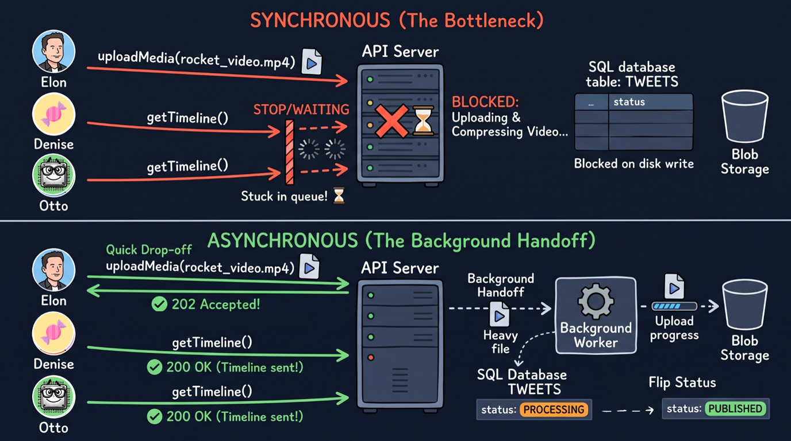

Let’s take a look at the picture, reader! As I mentioned, Elon calls `uploadMedia(rocket_video.mp4)` to send his massive video file to our API Server. Because a synchronous server can only focus on one step at a time and must wait for it to finish, the entire server gets completely locked up trying to compress that heavy video and write it to the database and Blob Storage. Look at what happens to Denise and Otto right below him: they are just trying to make a quick, lightweight `getTimeline()` call to read some tweets, but their requests hit a literal wall at the server door. They are stuck waiting in a queue staring at loading spinners simply because Elon’s heavy video is holding the entire API Server hostage!

Now, shift your eyes to the bottom half of the diagram to see how **asynchronous** execution saves the day. When Elon sends that exact same `uploadMedia(rocket_video.mp4)` request, our API Server doesn't waste time processing the video itself. Instead, it performs a quick drop-off: it creates a row for Elon's tweet in the `TWEETS` SQL table with its `status` set to `PROCESSING`, and immediately sends back a `202 Accepted!` response so Elon's app isn't frozen. Right after sending Elon on his way, the API Server does a background handoff, passing that heavy video file over to a separate **Background Worker**. Because the main API Server is now completely free and unblocked, look at Denise and Otto's `getTimeline()` requests: they sail right into the server and immediately bounce back with a `200 OK` and their timelines, with zero waiting! Meanwhile, behind the scenes, our Background Worker quietly finishes uploading the video into the **Blob Storage** bucket. The moment that upload reaches 100%, the worker hops over to our SQL database and flips the tweet's `status` from `PROCESSING` to `PUBLISHED`. 

Now that we see how synchronous and asynchronous execution work, you might be wondering: why don't we just make *everything* in our Twitter system asynchronous? Well, some operations actually *need* our server to wait before replying, while others belong strictly in the background. Let's quickly draw the line between what runs synchronously and what runs asynchronously in our architecture.

First, any operation where the user is actively staring at their screen waiting for an immediate answer—or where security and data safety are on the line—must happen **synchronously**. Take our `getTimeline()` endpoint, for example. We cannot hand Denise a `202 Accepted` status and tell her *"We will send your timeline later!"* when she opens her app—she wants to read her feed right now! The same rule applies to saving the initial text of a simple tweet to our SQL disk. The client needs a firm guarantee that their text was safely captured before moving on.

On the other side, heavy tasks that the user doesn't need to wait for should always run **asynchronously** in the background. As we just saw in our diagram, compressing and uploading massive video files in `uploadMedia()` is an asynchronous execution. Another example is updating timelines across the system: when Elon posts a new tweet, our server saves his text to the database synchronously so he knows his post is safe, but sliding that new `tweetID` into the cached timelines of his millions of followers happens asynchronously in the background. Even flushing our cached `like_count` numbers to the SQL disk, or running the recommendation algorithm to find trending posts, happens asynchronously behind the scenes.

## Pub/Sub Architecture

We just saw how splitting our workload into synchronous and asynchronous tasks keeps our API Server from freezing up. In our diagram, handing a single heavy task off to a Background Worker looked clean and effortless. However, step back and think about the huge scale we calculated back in the very first part of our system requirements. We are not dealing with just Elon, Denise, and Otto—we are dealing with hundreds of thousands of requests hitting our servers at the exact same second. At any given millisecond, countless synchronous and asynchronous tasks are queueing at the door: videos waiting to be compressed, millions of timeline lists waiting to be updated, like counters waiting to be flushed to the SQL disk, and recommendation engines hungry for new data.

When our traffic spikes to that massive speed and volume, simply tossing tasks directly from our API Server to a Background Worker stops working. If fifty thousand users call `postTweet()` and `uploadMedia()` at the exact same instant, our Background Workers will get completely flooded. When a worker is already operating at 100% capacity and the API Server keeps throwing thousands of new jobs directly at its face, what happens? Tasks get dropped on the floor! In that kind of chaos and speed, our system can easily lose track of who sent what, or completely forget to process a request—leaving Elon’s tweet stuck on `PROCESSING` forever, or failing to deliver his post to half of his followers' timelines.

We need a middleman that can catch every single asynchronous event fastly, hold onto it safely in an organized queue so nothing is ever lost, and distribute those tasks to the right workers at a pace they can actually handle. Welcome to **Pub/Sub (Publish/Subscribe) Architecture**!

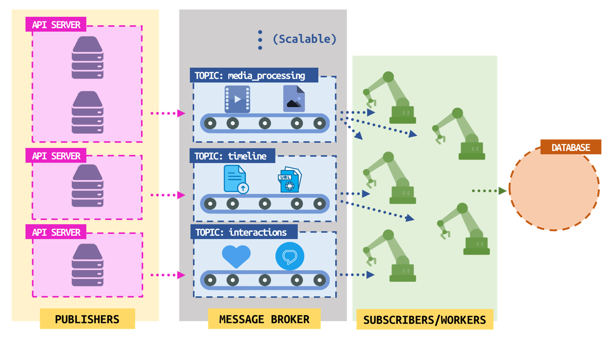

On the left side, the API servers work as "Publishers". When users interact with the application, these servers receive the requests and send them as messages to the next layer instead of doing the heavy work directly.

In the middle, the Message Broker organizes incoming messages into different "Topics" based on their category. This layer is scalable, meaning you can easily add more topics as the system grows.

On the right side, the "Subscribers/Workers" listen to specific topics. As shown by the arrows, multiple workers can take tasks from the same topic at the same time to share the workload and work faster. Finally, after the workers finish processing the tasks, they save the results into the Database on the far right.

Now, let’s zoom in on that relationship between our Workers and the Database, because a massive architectural question is hiding right there. In a perfect world, a worker pulls a message from the topic, processes it, and saves the result. But what happens when things go wrong in the real world? Imagine a worker grabs Elon’s heavy rocket video from the `media_processing` topic, gets halfway through compressing it, and suddenly the worker crashes! Or what if the database server temporarily loses connection right while the tweet is being processed? How will our system ever know that a worker died on the job instead of just taking a little longer than usual?

To solve this, we rely on the exact same state-tracking logic we designed earlier for our main SQL database. Whether our workers update the main `TWEETS` table directly or use a dedicated worker-tracking table with the exact same structure, having a `status` column and a timestamp is our ultimate safety net. The very millisecond a worker pulls a task from a topic, it reaches out to the SQL database and makes sure that tweet's `status` is set to `PROCESSING`. From that moment on, the clock is ticking.

Remember earlier in the SQL episode when I mentioned that `created_at` would be a lifesaver for catching tweets stuck on `PROCESSING`? And remember the **Heartbeat** mechanism we talked about back in our Leader Election episode, where servers periodically send signals to prove they are still alive? We can combine those two exact ideas right here! While our workers are busy crunching tasks, our system runs a periodic health-check query against the database at regular intervals—acting just like a heartbeat monitor. This query sweeps through the table looking for any row where the `status` is still stuck on `PROCESSING`, and checks if the difference between the current time and the `created_at` timestamp has exceeded our allowed time interval, say, five minutes. If a task has been sitting in `PROCESSING` for more than five minutes without a worker finishing it or refreshing its heartbeat, our system knows the worker crashed or failed! It immediately steps in to mark the status as `FAILED` and increments a retry counter so another healthy worker can either try again or move the broken task out of the way. Here is what that heartbeat sweeps query looks like:

```sql
UPDATE TWEETS
SET status = 'FAILED',
retry_count = retry_count + 1
WHERE status = 'PROCESSING' AND CURRENT_TIMESTAMP - created_at > INTERVAL '5 minutes';
```

Once a worker avoids all disasters, finishes its job, and flips the tweet's status to `PUBLISHED`, you might think its work is completely done. Not quite! Right after completing a message from the queue, our system runs one more clever query to check the database for any other active or pending messages belonging to that exact same `userID`. Why would a worker care about other tweets from the same user? Think about how people actually use Twitter! Imagine Elon is posting a three-part thread about his Mars mission, or he uploads a heavy video tweet (`tW7pB3vC908`) and ten seconds later posts a quick text follow-up replying to it. Because we have multiple workers pulling from our topics concurrently to work faster, a second worker might grab Elon's quick text tweet and finish it in a millisecond, while the first worker is still sweating over his massive video file! If we aren't careful, Elon's followers will see the second part of his thought on their timelines before the first part even exists, or two workers might collide while trying to update Elon's `user:2R9geR6b007:tweets` cache list and his `tweet_count` at the exact same instant.

By querying the database for other messages tied to `userID = '2R9geR6b007'` right after a task finishes, our worker can check if this user has other tweets waiting in line or currently in flight, sorted by their `created_at` timestamp. This allows our system to enforce strict chronological order for a single user's posts, chain related tasks together while the user's data is already warm in memory, and update the user's cached timeline list cleanly without race conditions. Let's take a look at the query our worker runs to inspect the rest of Elon's pipeline right after finishing a task:

```sql
SELECT tweetID, content, status, created_at
FROM TWEETS
WHERE userID = '2R9geR6b007' AND status IN ('PENDING', 'PROCESSING')
ORDER BY created_at ASC;
```

<aside>
💡

For routing heavy background jobs like our `media_processing` topic with strict delivery guarantees, **RabbitMQ** is a good choice Since we already use **Redis** for caching in our architecture, we can also use **Redis Pub/Sub** or **Redis Streams** for ultra-fast, in-memory messaging. Finally, if we want a solution without managing any servers ourselves, cloud providers offer fully managed services like **Google Cloud Pub/Sub** and **AWS SNS/SQS** that effortlessly scale to millions of messages per second behind the scenes.

</aside>

## System of Twitter

Take a deep breath and look at how far we have come, learner! We started with a single button click and an empty storage box, and piece by piece, we discovered why a real-world platform needs load balancers, rate limiters, caches, databases, and message queues. Now, it is time to put all of those puzzle pieces onto the same table and watch how our complete Twitter architecture operates from start to finish.

### Complete Schema

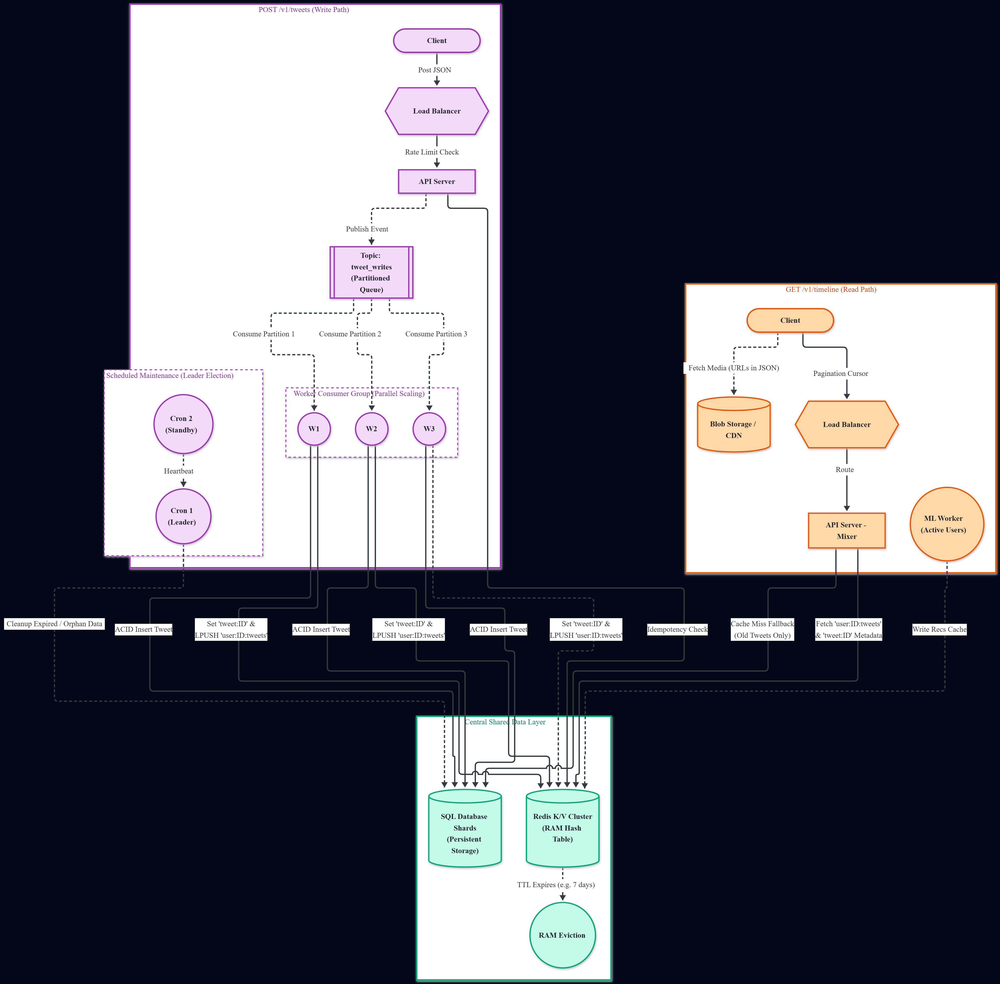

Let’s trace the life of a tweet by looking at the `POST /v1/tweets (Write Path)` on the left side of our complete system scheme. Imagine Elon writes a new post and presses that famous POST button. Once the TCP and TLS handshakes establish a secure connection, his client sends the JSON payload toward our servers. Instead of hitting a backend machine directly, the request arrives at our Load Balancer, which acts as a reverse proxy at the front door. Right before the request is allowed into our application logic, it must pass the Rate Limit Check  that makes sure Elon’s IP address isn't flooding the system with too many requests at once. Once approved, the request lands on an available API Server. Notice a crucial step right here in the scheme: the API Server performs an `Idempotency Check` against our K/V Database. Why? Imagine Elon is on a shaky train Wi-Fi connection and accidentally taps the POST button three times in a row. By checking a unique request key first, our server makes sure it doesn't publish the exact same tweet three times!

Once the request passes the idempotency check, our API Server doesn't waste time writing to the database directly. Instead, it acts as a Publisher in our Pub/Sub architecture and sends the event straight into `Topic: tweet_writes`, which is organized as a partitioned queue. From there, our `Worker Consumer Group` (`W1`, `W2`, and `W3`) pulls tasks from `Partition 1`, `Partition 2`, and `Partition 3` in parallel so we can scale horizontally as traffic grows. Each worker reaches down into our `Central Shared Data Layer` to complete two essential jobs: first, it executes an `Insert Tweet` operation to permanently store the tweet inside our `SQL Database`; second, it updates our `K/V Database` in RAM by setting the `tweet:ID` metadata key and running an `LPUSH` command on `user:ID:tweets` to push the new tweet ID right to the top of the cached timeline list.

Now, shift your eyes to the right side of the scheme to see what happens when Denise opens her app and triggers `GET /v1/timeline (Read Path)`. Her client sends a GET request—carrying a `Pagination Cursor` that we will unpack in just a moment—through the Load Balancer, which routes her to our `API Server - Mixer`. Why do we call this server a Mixer? Because a timeline isn't just a raw list anymore! Alongside regular posts, notice the `Machine Learning Worker` sitting next to it. That machine learning worker continuously analyzes active users in the background and writes recommended tweet IDs (`Write Recs Cache`) directly into our K/V database. When Denise requests her feed, the Mixer reaches into the `K/V Cluster` to fetch the `user:ID:tweets` lists and the corresponding `tweet:ID` metadata in less than a millisecond, blending tweets from people she follows with personalized recommendations. What if Denise gets curious and scrolls all the way back to an old tweet that is no longer sitting in RAM? The Mixer triggers a `Cache Miss Fallback (Old Tweets Only)` and retrieves that historical record from our `SQL Database`. Finally, once Denise’s client receives the JSON response containing the tweet texts and media links, her device uses those URLs to separately fetch the heavy images and videos directly from our `Blob Storage`.

Wait a second—look closely at how Denise fetched those images and videos from the `Blob Storage`. Earlier, in the CDN episode, we talked about how fiber-optic cables cannot beat the laws of physics: if our servers are in the United States, forcing a user in Asia or Europe to fetch heavy media across oceans introduces hundreds of milliseconds of latency. A CDN solved that for static files by placing copies of images and videos on edge servers close to our users. But what about our `Central Shared Data Layer`? If our SQL Database Shards and K/V Database only live in a single data center in America, every single `postTweet()` and `getTimeline()` API call from the rest of the world still has to travel across continents!

To make Twitter truly global, we have to take the exact same philosophy behind our CDN and apply it to our databases through global database replication. Instead of keeping all our data in one place, we replicate our SQL shards and K/V clusters across multiple geographical regions around the world. However, replicating a database is much trickier than copying a static image to a CDN, because database records are constantly changing every millisecond. If we forced every new tweet to be written to databases in America, Europe, and Asia synchronously, the user would be stuck staring at a loading spinner waiting for undersea cables to finish talking. Instead, we replicate our databases asynchronously!

Let’s talk about that what this looks like in the real world. Imagine a user sitting in a café in Mumbai, India writes a tweet and hits POST. Their request is routed to the closest regional data center in India, where the local API server and workers write the tweet to the Indian database shard and local Redis cache immediately. For that user in India—and for millions of other users across Asia connected to that same regional cluster—the tweet exists right away. Behind the scenes, without making the Indian user wait a single millisecond, our system packages that database write and sends it asynchronously across the ocean to our database replicas in Europe and North America. Now, imagine a user in New York refreshes their timeline at the exact same millisecond the POST button is pressed in Mumbai. Will they see the tweet? Not yet! Because the replication happens asynchronously across thousands of kilometers of fiber-optic cables, it takes roughly 100 to 500 milliseconds—or during massive traffic spikes, a second or two—for that data packet to travel across the world and be written into the American database shards and caches. The moment that background replication finishes, the tweet seamlessly appears on American timelines. In system design, we call this *Eventual Consistency*: a user in America might see a tweet from India a heartbeat later than someone sitting in Mumbai, which is a tiny trade-off that allows every user on Earth to experience blazing-fast local speeds.

Of course, whenever we copy millions of records asynchronously across continents, things can go wrong. A brief network hiccup in an undersea cable or a momentary server overload could cause a replication message to drop, leaving the American database missing a tweet that exists in the Indian database. How do we catch and fix missing data across global replicas without causing chaos? We assign a dedicated group of background reconciliation servers to check for missing or out-of-sync records across regions. But remember what we learned in the Leader Election episode: if ten reconciliation servers all notice the same missing tweet between India and America at the exact same time and try to overwrite the database simultaneously, we end up with race conditions and corrupted data! To prevent this, our reconciliation cluster uses Leader Election—just like the heartbeat mechanism between `Cron 1 (Leader)` and `Cron 2 (Standby)` shown in our scheme. One server is elected as the leader to coordinate cross-region consistency checks, comparing database logs and instructing lagging replicas to fetch whatever missing data they need, while the standby servers monitor its heartbeat and wait to step in if the leader ever goes down.

Speaking of `Cron 1 (Leader)` and `Cron 2 (Standby)` on the left side of our scheme, let’s look at how our system handles data that needs to be deleted. With 500 million tweets arriving every single day, we cannot keep everything in expensive RAM forever, nor can we let broken or deleted data pile up on our SQL disks. Our deletion strategy works on two fronts: automatic memory eviction in Redis, and coordinated background cleanup in SQL.

First, look at the bottom of our `Central Shared Data Layer` in the scheme: right below the `Redis K/V Cluster`, you can see `TTL Expires (e.g. 7 days)` leading to `RAM Eviction`. Because RAM is limited and only meant for hot data—like recent tweets and active timelines—we attach a Time-To-Live countdown to our cached keys. Once a tweet has been sitting in Redis for 7 days and the world has moved on to newer posts, its timer expires and Redis automatically evicts it from RAM to make room for fresh tweets, while the permanent record stays safely stored inside our SQL Database Shards.

Second, what happens when a user actively deletes a tweet, or when an upload crashes and leaves records behind? When a user deletes a post, we immediately remove its key from Redis so it vanishes from timelines right away. However, running heavy physical disk deletions on massive SQL tables during peak daytime traffic can lock database pages and slow down other queries. Instead, we initially mark the record as deleted (a technique called *soft deletion*) or leave expired processing records flagged in the table, and let our `Scheduled Maintenance (Leader Election)` cluster handle the heavy lifting. As shown in the scheme, `Cron 2 (Standby)` continuously monitors the `Heartbeat` of `Cron 1 (Leader)`. At scheduled intervals, the active leader `Cron 1` runs the `Cleanup Expired / Orphan Data` process against our `SQL Database Shards`, permanently wiping out soft-deleted tweets, abandoned `FAILED` rows, and unlinked media references without any other maintenance server duplicating the work.

Now, let’s return to a detail we spotted earlier at the very top of the `GET /v1/timeline (Read Path)` in our scheme: right between the `Client` and the `Load Balancer`, the request carries a `Pagination Cursor`. Why did we add that to our architecture, and why wasn't our original `getTimeline(userID)` function enough?

Think back to the API Functions episode where we first wrote `getTimeline(userID)`. In that simple version, Elon sent his `userID` to `/v1/timeline?userID=2R9geR6b007`, and the server returned his timeline list. But let’s think about what happens after Elon uses Twitter for a year. The people he follows have posted hundreds of thousands of tweets, and our recommendation engine has thousands more waiting for him. If calling `getTimeline("2R9geR6b007")` forced our server to grab 100,000 tweets from Redis and SQL and send all of them back in a single massive JSON response, the API server would run out of memory.

To prevent this disaster, we use **Pagination**. Instead of serving the entire timeline at once, we slice the feed into small, lightweight batches—say, 20 tweets per request. When Elon opens his app, we only send him the newest 20 tweets. When he scrolls down and reaches the bottom of those 20 tweets, his client automatically triggers another `getTimeline()` call to fetch the next batch of 20.

But how does the server know where Elon left off? On an old-fashioned website, you might use page numbers (like asking for "Page 1, items 1 to 20" and then "Page 2, items 21 to 40"). However, on a real-time system like Twitter, page numbers break completely! Imagine Elon opens his app and loads the top 20 tweets. While he spends ten seconds reading them, the people he follows publish 5 brand-new tweets, which get pushed (`LPUSH`) to the very top of his `user:ID:tweets` list in Redis. Everything in Elon’s timeline just shifted down by 5 positions! If his app now asks the server for "items 21 to 40", the first 5 tweets of that new batch will be the exact same tweets he just finished reading at the bottom of his first screen.

To solve this shifting-list problem, we use **Cursor-Based Pagination**. Instead of counting positions from the top, a cursor acts like a bookmark pointing to a specific tweet—usually the unique `tweetID` or the exact `created_at` timestamp of the very last tweet Elon received in his current batch. When the client asks for more tweets, it simply hands that bookmark back to the server and says: *"Give me the next 20 tweets published right before this exact cursor!"* Even if a hundred new tweets arrive at the top of Elon's timeline in the meantime, his bookmark stays locked on the exact tweet where he stopped scrolling.

Let’s refactor our `getTimeline()` function from the API episode to include our new `cursor` and `limit` parameters!

JavaScript

```
function getTimeline(userID, cursor = null, limit = 20){
  let url = `/v1/timeline?userID=${userID}&limit=${limit}`;
  if (cursor) {
    url += `&cursor=${cursor}`;
  }
  return httpClient.get(url);
}
```

When Elon opens his app for the very first time today, he hasn't scrolled yet, so `cursor` is `null`. Once he scrolls to the bottom of those first 20 tweets, look at the last tweet in his batch—say its ID is `tW1mZ5yH634`. His client now calls `getTimeline("2R9geR6b007", "tW1mZ5yH634", 20)`, which sends the following HTTP GET request through our Load Balancer:

HTTP

```
GET /v1/timeline?userID=2R9geR6b007&limit=20&cursor=tW1mZ5yH634
```

Our `API Server - Mixer` receives this cursor, jumps straight to `tW1mZ5yH634` inside Elon’s cached list in Redis, grabs the next 20 tweets older than that marker, and returns both the tweets and a brand-new cursor for the next scroll:

HTTP

```
HTTP/1.1 200 OK
Content-Type:application/json

{
  "timeline": [
    ...20 tweets information as JSON...
  ],
  "next_cursor": "tW9xL2mP401"
}
```

Now, the client renders the new batch seamlessly and saves `"tW9xL2mP401"` in its pocket, ready for the next time Elon’s thumb swipes up on the screen!

There is just one final piece we need before we can hand this system over to the real world: how do we actually watch over all of these moving parts once the system is running? When you have hundreds of servers working together across continents, you cannot simply wait for users to complain that Twitter is down. If Worker `W2` starts crashing while compressing videos, or if a Redis node begins running out of RAM, or if API response times in Europe suddenly jump from 20 milliseconds to 3 seconds, our engineering team needs to know immediately.

This is where **Logging and Monitoring** come in as the eyes and ears of our architecture. Whenever an important event or an unexpected error happens inside any of our components—such as an API server returning a `500 Internal Server Error`, a worker failing to insert a tweet into a SQL shard, or `Cron 1` losing its heartbeat—the server writes a structured record of what happened, when it happened, and which request caused it. Collecting these logs in a centralized system allows us to trace a single failed request across our entire pipeline to find the exact bug in seconds. At the same time, **Monitoring** tools (such as Prometheus and Grafana) continuously collect real-time health metrics from every box in our scheme: CPU and memory usage, cache hit versus cache miss ratios in Redis, the number of unprocessed messages piling up inside `Topic: tweet_writes`, and overall network latency. If any of those numbers cross a dangerous threshold and threaten our 99.99% availability target, our monitoring system triggers an automated alert to wake up the engineers before a small hiccup turns into a global outage.

<aside>
💡

Well, congratulations! You designed the system of Twitter.

</aside>

## Last but Not Least

Even though we just designed an architecture capable of handling three core API endpoints with four-nines availability, a real production environment requires far more fine-tuning, from stricter security layers to complex failure recovery. Think about everything else running on Twitter right now: you need deeply nested comment threads, a real-time recommendation engine, targeted advertisement pipelines, social graph services for following and blocking users, Grok AI integration, profile management, automated moderation engines to catch banned or copyrighted content, and an instant push-notification system. Every single one of these features demands a sub-system just as massive as the one we built, and they all have to remain completely compatible with one another. Clearly, building a platform at this scale is never a one-person job; it takes an entire army of engineering teams. That is why, after you learn the fundamentals of System Architecture, you must also learn how to collaborate as part of a team, break giant problems down into independent services, and design clean boundaries so your piece of the puzzle fits seamlessly into the bigger machine.
